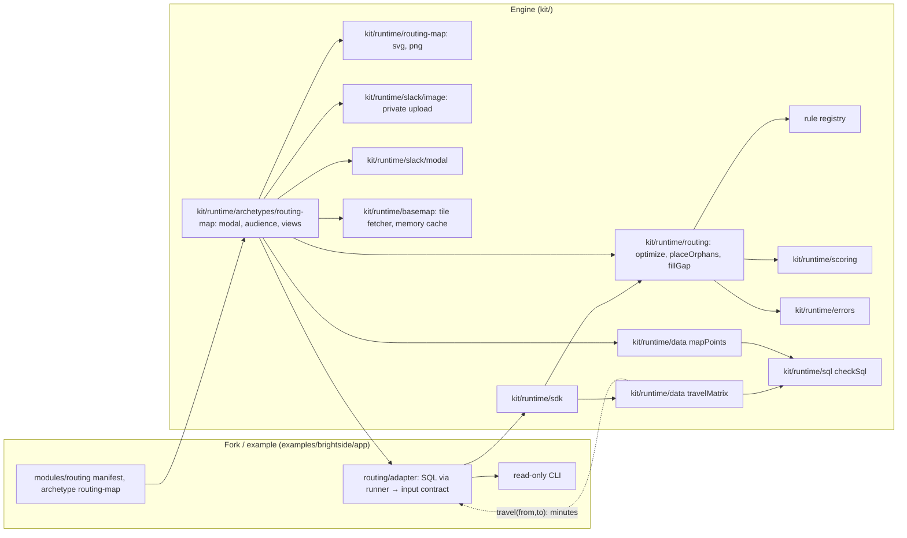

# Architecture Spine: AP Labs routing

Decisions only. Inherits `architecture-runtime.md` (AD-1 engine/fork boundary, AD-9 the only query runner, AD-16 optional profile keys, AD-17 typed errors, AD-18 fixture tooling) read-only. Every story in `epics-routing.md` builds against these rules.

**Amended 2026-10-26 (routing-streetmap):** Ely decided, after seeing the plain plot in dev Slack ("we need a map here"), to put a street map under the plot: free OpenStreetMap tiles ($0, no account), the demo company moved onto a real US metro (Columbus, Ohio), and new Stories 15.7 to 15.11 built now. Adds AD-R18 to AD-R22; amends AD-R10, R12, R13, R14 and the deferred list. Architect review: approve with conditions, all folded in. Drive time is unchanged: haversine × detour ÷ speed, not road time.

- **Gate items for Ely:** (1) `approve plan routing-streetmap`; (2) the new outbound connection, `kit/runtime/basemap` to the tile provider (DEP-029); (3) the PNG size cap changes from a fixed 1 MB to a measured cap of at most 4 MB (AD-R21); (4) the attribution is a caption under the image, not drawn into it (OpenStreetMap allows attribution next to the map; the architect's reading); (5) the tile cache is memory only, nothing on disk; (6) the contact address in the tile requests' User-Agent (DEP-030).
- **Risks:** the larger PNG may pass Slack's modal image limit (unverified; measured, falls back to the plain map, a live-check item). 15.7 may grow to L if S2's or S3's planted shape breaks in the new place. OpenStreetMap may block our User-Agent or IP, or withdraw free use (the plain map shows; forks move to a paid provider, DEP-031). The attribution is lost if the image is copied (the caption sits beside it, not in it). resvg decoding data-URI images on the shipped image is untested until CI runs the smoke script.
- **Cut list, if short on time:** ETag revalidation; the white wash; the 10-minute cool-down (any 403 or 429 then turns the street map off until restart); merging 15.9 into 15.10. **Never cut:** off by default plus the kill switch; the plain-map fallback; User-Agent and attribution; no URLs or tile numbers in logs; `unsafe_svg` intact; the Web Mercator projection; GRD-002 reworded and re-signed by Dana.

**Amended 2026-10-27 (routing-editor):** Ely asked for a two-step Slack flow to plan one crew's day by hand: step 1 picks a crew and a date; step 2 lists the stops with ↑/↓ to reorder, a map at the top redrawn for the current order, an Optimize button, and the total estimated drive time and distance at the top. Every crew starts and ends at one "Office", a point in Westerville, Ohio, stored rounded to 0.002° and shown only as "Office", never as an address. Ely's choices: the office rounded in the demo; ↑/↓ arrows; a manual order that breaks rules is allowed and flagged, with a count at the top; the four-view Routing screen stays and a new menu option, "Plan a route", is added; suggest only (nothing written back); the same audience as Routing. New Stories 15.12 to 15.15. Adds AD-R23 to AD-R28; amends AD-R2, R9, R12, R16. Story 15.6 now adds `prod` to both routing modules, after DEP-025 and DEP-032. Architect review: approve with conditions; the conditions are gate items below.

- **Gate items for Ely:** (1) `approve plan routing-editor`; (2) AD-R23: the Office is a row in the data, not coordinates in the profile (this changes Ely's "in the profile" wording); (3) DEP-035: the Office point's provenance; (4) the new `depots` table, the `km_tenths` column in `travelMatrix`, the `routing.depot` profile key and the module `screen` field.
- **Risks:** a node source declared without its table breaks every routing read (so table and profile change ship in one PR, and DEP-033 republishes); showing the earlier image again in `views.update` is unverified (fallback: the list without the image); Slack rate limits (about 6 calls per change; the 750 ms wait and the superseded-click skip bound it; a refused delete falls to the sweep); wide maps for crews far from the office in Westerville; two answers for one crew (Routing from crew bases with no return, Plan a route from the Office with a return), handled by a fixed note and DEP-034; preferred-crew warnings cannot be fixed by reordering.
- **Cut list, if short on time:** the two-step update (one combined update instead); the 750 ms wait; map positions held in the session; Reset to booked; read-only for a crew that is out. **Never cut:** no coordinates in the profile or in JS; the version check on every click; scope from the audience, never from the click; dev only until DEP-025 and DEP-032; the file lifecycle and sweep; suggest only; a leg's distance never shown.

## Design Paradigm

**Functional core, imperative shell.** `kit/runtime/routing` is a pure function library: typed input in, plan out, no I/O, clock, randomness or LLM. `kit/runtime/routing-map` is a second pure library: plan plus pixel points in, SVG out (one file turns SVG into PNG). The shell (a client adapter in the app dir, `travelMatrix` and `mapPoints` in `kit/runtime/data`, and the `routing-map` archetype in Slack) reads data, builds the input and shows the result.



Dependency rule: `kit/runtime/routing/**` may require only `kit/runtime/scoring`, `kit/runtime/errors` and its own files. It never requires `data`, `sql`, `llm`, `slack`, `connectors`, `store`, `routing-map` or any `archetypes`, and never names `examples/`. `kit/runtime/routing-map/**` may require only `kit/runtime/errors`, its own files and (in `png.js` only) the rasterizer; it never requires `routing`, `data`, `sql`, `llm`, `slack`, `connectors` or `store`. Only `kit/runtime/archetypes/routing-map/**` may require `kit/runtime/data/map.js`. **Amended 2026-10-26 (routing-streetmap, AD-R19):** `kit/runtime/basemap/**` may require only `kit/runtime/errors` and its own files; only `kit/runtime/archetypes/routing-map/**` and `scripts/smoke-routing-map.js` may require it; `kit/runtime/routing-map/**` never requires it. All of these are grep tests in `engine-boundary.test.js`. App code reaches routing and `travelMatrix` only through `kit/runtime/sdk` (runtime AD-1); `mapPoints` is not in the sdk, so no module or adapter can call it.

## Invariants & Rules

### AD-R1: The engine is pure and never reads client tables
- **Binds:** CAP-1, CAP-2, CAP-3, CAP-4
- **Prevents:** Brightside table names in the kit; nondeterminism from I/O or time.
- **Rule:** Three entry points: `optimizeDay(input, opts)`, `placeOrphans(input, opts)`, `fillGap(input, opts)`. Each takes the input contract (AD-R2) plus `{ travel, rules, budget }` and returns a plain object. No `Date.now`, no `Math.random`, no async, no `require` outside the dependency rule. Same input → byte-identical JSON output (test runs each entry point twice and compares).

### AD-R2: One input/output contract [ADOPTED: data-design §4]
- **Binds:** all
- **Prevents:** each adapter inventing a shape; coordinates or names reaching the engine.
- **Rule:** Input and output are exactly data-design §4, with these fixes: times are integer minutes after local midnight (wall clock, never UTC); ids are strings, ordered by `scoring.compareIds`; a stop's `rules` holds rule instances `{ ruleId, value, strength? }` (AD-R4); a time window is `{ startFrom, startBefore }` minutes (the adapter maps `morning`/`afternoon`); a node is a kind-prefixed id string (`property:<id>`, `crew:<id>`), never a coordinate; dates are ISO strings only, never a local `Date`. The adapter sets a crew `available: false` when its lead is absent or nobody is present (pending Dana Reyes's confirmation). Output rows carry ids, minutes and `reason` only. `contract.js` validates input and throws `RoutingFault` (AD-17, mapped in `messages.js`) naming the field; it never coerces.
- **Amended 2026-10-27 (routing-editor, AD-R23):** a third node kind, `depot:<id>`, for the Office. The node pattern in `contract.js` and in `travel.fromMatrix` accepts it; any other prefix (for example `place:`) is still refused.

### AD-R3: Travel is a port; the engine sees only minutes
- **Binds:** CAP-5
- **Prevents:** the solver computing distance itself; a maps connector needing a solver edit.
- **Rule:** The engine receives `travel(fromNode, toNode) → integer minutes`, synchronous, built by `travel.fromMatrix(rows)` over a prefetched rectangle (from-nodes × to-nodes). A missing pair throws `RoutingFault` (never 0). No return leg to base by default (data-design §6); `opts.returnToBase` turns it on. The V1 estimator is `travelMatrix` (AD-R9): haversine × `detour_factor` ÷ `speed_kmh`, rounded to 1e-6 then up to a whole minute, floored at `min_travel_minutes`. A later maps connector supplies the same matrix shape; nothing in `kit/runtime/routing` changes.

### AD-R4: Rules live in a registry; strength is per rule instance, default hard
- **Binds:** CAP-4
- **Prevents:** rule logic in the solver; a new rule needing an engine edit.
- **Rule:** A rule is `{ id, label, defaultStrength: 'hard'|'soft', weight (integer ≥ 1, soft only), check(stop, slot, ctx) → { ok, reason } }`, added with `createRegistry().register(rule)`, which validates the shape and refuses a duplicate id or a bad strength or weight. The solver loops over the registry and knows no rule by name. **Strength decision:** a stop's rule instance may carry `strength`; absent, the rule's `defaultStrength` applies. V1 rules and defaults: `crew-day-limits` (earliest start, latest finish; always hard, not overridable), `day-of-week` (hard), `time-of-day` (hard), `preferred-crew` (soft, weight 100), `aim-finish` (soft, minutes past `aimFinish`; 23:00 hard / 18:00 soft; scored in its own tuple position, AD-R5, never summed with preferred-crew). Brightside's `service_rules` rows are all hard for day and window (SQLsmith), so Brightside behaves as all-hard; the contract keeps the per-customer soft option for other clients.

### AD-R5: The objective is lexicographic, in integers
- **Binds:** CAP-1, CAP-2, constraints
- **Prevents:** a lower priority trading against a higher one; float drift breaking determinism.
- **Rule:** Compare plans by the tuple `(hardBreaks, softPenalty, driveMinutes, aimFinishMinutes, orderKey)`, all integers; `softPenalty` sums soft rules other than aim-finish. No returned plan has `hardBreaks > 0`: a stop that cannot be placed without a hard break goes to `unplaced[]` with a reason (test fixture `contradictory-rules.json`). `orderKey` is the concatenated stopId order, so ties always break by stopId.

### AD-R6: The solver is construction plus bounded local search
- **Binds:** CAP-1
- **Prevents:** run-to-run differences; an unbounded solve; a "better" plan worse than the booked one.
- **Rule:** Construction is cheapest feasible insertion in stopId order; improvement is relocate, swap and 2-opt within a crew, then relocate between crews of the same zone, first-improvement in a fixed move order. The time box is a **move-evaluation budget** (`budget`, default 20 000, from config), never wall clock, so slower machines give the same answer. Finally the result is compared with the booked order under AD-R5; if not strictly better, and only if the booked order breaks no hard rule, the booked order is returned with the reason "booked order is already best". Locked stops keep their crew and start. Optimize never moves a stop across zones. Quality bar: never worse than booked (every fixture test) and equal to the brute-force optimum on a ≤ 7-stop known-optimal test fixture.

### AD-R7: Route change places orphans by insertion cost; cross-zone is a recommendation only
- **Binds:** CAP-2, CAP-6
- **Prevents:** a broken day silently reshuffling other crews; a cross-zone move applied unseen.
- **Rule:** Orphans (stops of an unavailable crew) are taken hardest first (fewest feasible in-zone crews, then stopId) and inserted at the cheapest feasible position on a receiving crew. Receiving crews' existing stops keep their order; their starts may only shift within their own hard rules, and every shifted stop gets a `shifted[]` row "call to confirm the new time". If every crew is out, every stop goes to `unplaced[]` (test fixture `all-crews-out.json`). With no feasible in-zone slot, the cheapest cross-zone slot goes to `moves[]` with `crossZone: true, recommendation: true` and is not in any crew's plan. With none at all, the stop goes to `unplaced[]` with a plain reason ("call to rebook"); rescheduling to another day is out of scope.

### AD-R8: Gap fill filters on hard rules, then ranks with kit/runtime/scoring
- **Binds:** CAP-3
- **Prevents:** a second scoring formula; candidates that break a rule on the gap's slot.
- **Rule:** A gap runs from the previous stop's end (or the crew-day start) to the next stop's start (or the crew-day latest finish); adjacent cancellations merge into one gap. Candidates come only from `input.candidates` (the adapter's (gapDate, gapDate + 14] pull), never the property that cancelled and never a property already visited on the gap date; `prevVisitDate` is the latest non-cancelled visit from history or schedule. A candidate fits only if travel in + service + travel out fits inside the gap and no later stop shifts; it is kept when every hard rule passes in that slot and the move respects cadence (not closer than half its `cadenceDays` to `prevVisitDate`). A gap too small for every candidate returns an empty list with a reason. Several gaps on one crew may share a candidate: each row lists `alsoOfferedFor[]`, and the caller may pass `exclude[]`. Travel for ranking is the rectangle of the gap's two neighbours × the candidates. Survivors are ranked by `scoring.rank()` with an engine-declared spec (`row_id: stopId`; inputs: extra drive minutes (negative weight), flexible (0/1), days the visit moves up (negative), window fit (0/1)); weights default in the engine and may be overridden by `routing.gap_fill.weights`, checked by `checkScoring`. Top `limit` (default 5). `flexible` is a contract field the adapter sets; the engine never infers it.

### AD-R9: travelMatrix reads coordinates and returns only minutes
- **Binds:** CAP-5, CAP-7, constraints
- **Prevents:** coordinates reaching module SQL, logs, Slack or an LLM; a general "unforbid" switch.
- **Amended 2026-10-26:** `travelMatrix` is no longer the only coordinate read. `mapPoints` (AD-R13) is the second, built the same way under the same guard. No third may be added without an architect review. Neither returns a latitude or longitude.
- **Rule:** `travelMatrix(fromIds, toIds)` is built inside the `createData` closure (`kit/runtime/data/travel.js` holds the template), so it shares the guard, the 30 s timeout and redaction; the returned data object is frozen and a test asserts its exact keys (no override flag, no raw connection). It runs one static SQL template whose identifiers come from `routing.coordinates` and pass the identifier regex. Before running it checks that each declared coordinate column is INTEGER or BIGINT (declaring `street_address` is refused, with a test); every DuckDB error is wrapped in a fixed-text `RoutingFault`. It calls `checkSql` with the profile's forbidden list minus exactly the declared coordinate columns; every other forbidden column still applies. Profile validation refuses a `routing.coordinates` column that is not also in `sql.forbidden_columns`, or whose column type (checked at first use) is not INTEGER or BIGINT. The select list is fixed to `from_node, to_node, minutes` (INTEGER); node ids are kind-prefixed bound parameters; the rectangle is capped at `routing.max_pairs` (default 10 000) pairs. `run()` gains no option: a test proves `run()` still refuses a coordinate column and no other export can drop a forbidden column. Exposed to app code via `kit/runtime/sdk`.
- **Amended 2026-10-27 (routing-editor, AD-R25):** the select list becomes `from_node, to_node, minutes, km_tenths` (all INTEGER). `km_tenths` is round(haversine × `detour_factor` × 10) from the same CTE. The engine still sees minutes only; the adapter builds `distance(from, to)` from the extra column. Only a route's total is ever shown, in whole km; a leg's distance is never shown, logged or sent.

### AD-R10: Profile changes are one optional `routing:` block [extends runtime AD-16]
- **Binds:** CAP-5, CAP-7
- **Prevents:** routing limits in code; unknown keys slipping past the schema.
- **Rule:** `profiles/_schema/profile.schema.json` gains `routing` (`additionalProperties: false`): `coordinates.nodes[]` `{ kind, table, id_column, lat_column, lon_column }` (micro-degree INTEGER), `speed_kmh`, `detour_factor`, `min_travel_minutes` (5), `max_pairs` (10 000), `limits` `{ earliest_start, default_start, aim_finish, latest_finish, slot_minutes }`, `gap_fill` `{ horizon_days: 14, limit: 5, weights? }`. Absent block = routing off. Defaults are filled in `validateProfile`, after the profile is hashed (the hash covers what the client wrote); no `schema_version` bump. An older kit rejects a `routing:` block (fork-guide note). Brightside's profile adds the four coordinate columns to `sql.forbidden_columns` (before the generator adds them) and a `routing` block with the generator's limits (06:00, 08:00, 18:00, 23:00, 15). **Amended 2026-10-26:** Story 15.2 adds `max_points` (500), `map_grid_e6` (2000; smaller refused), `map_min_span_km` (5; smaller refused) and `audience` (AD-R17) to the same block. The two map floors are refused below their defaults because Dana signs GRD-002 against those numbers. **Amended 2026-10-26 (routing-streetmap):** Story 15.9 adds the optional `basemap` block (AD-R18): `url_template`, `attribution`, `attribution_url`, `user_agent`, `max_zoom` (0 to 19, default 19), `cache_days` (7 or more, default 7) and `max_cached_tiles` (default 512). No block, no street map.

### AD-R11: Suggest only, explained, no location as text
- **Binds:** CAP-6, non-goals
- **Prevents:** a hidden write path; unexplained or location-leaking output.
- **Rule:** Routing has no write path and imports no connector (the write-path check covers it). Every output row has a `reason` built from rule labels, crew ids and minutes only. Output and reasons never contain a coordinate, street address or postal code (test scans the serialized output for the coordinate column values). No routing input or output is sent to the LLM. **Amended 2026-10-26:** the one allowed way a location reaches Slack is the map image, under AD-R12.

### AD-R12: Location never as text; the map image only in the routing modal [T3 guardrail change]
- **Binds:** CAP-8, CAP-9, constraints
- **Prevents:** a location leaking through text, logs or the LLM; the map image spreading past the people allowed to see it.
- **Rule:** No coordinate value, street address or postal code ever appears as text anywhere: Slack text, alt text, logs, reasons, errors, LLM input. Pixel positions (AD-R13) and the SVG are treated the same way: process memory only, never logged, stored or sent. The only thing that leaves is the PNG. It is shown only inside the routing modal, only to the routing audience (AD-R17), never posted to a channel, never sent to an LLM; it is uploaded privately and deleted after use (AD-R15). The image reveals approximate locations: it has no tiles, scale or axis values, but anyone who knows where two places on it are can line it up with a real map. **Precision, in numbers (F1):** before projection every place is snapped to a 0.002° grid (`routing.map_grid_e6` 2000), a cell about 220 m north-south and about 140 to 190 m east-west at 30° to 50° latitude, so a marker is within about 150 m of the real place and never closer; places in one cell share a marker. Every map covers at least 5 km each way (`routing.map_min_span_km`), so it cannot zoom in on one street. On an 800-pixel map of 5 km a pixel is about 6 m, finer than the grid, so the grid sets the precision. A file lives at most 20 minutes after upload (AD-R15). This is a T3 guardrail change. It replaces the earlier "coordinates never reach Slack" wording (SPEC constraints, AD-R9, AD-R11). Decision: Dana Reyes signs it as an update to Brightside's GRD-002 at **Story 15.5**, not in 13.3, so she signs it with the spike's outcome (AD-R15) in hand and 13.3's sign-off stays narrow. No Brightside module shows a map until that sign-off is recorded.
- **Amended 2026-10-26 (routing-streetmap):** "it has no tiles" no longer holds when a profile turns on the street map (AD-R18). With it on, the picture has a street map under it: anyone who sees it can read each marker's area directly, to about 150 m (a block), with no need to line it up, and next to the text list (client name, city, stop number) a screenshot shows roughly where a named client lives. The grid, the 5 km floor and the 20-minute file life are unchanged; a whole-zoom frame may show up to twice the area (AD-R20). **Tile-server exposure:** to draw the streets the bot asks the tile provider for the squares of the area shown, so the provider learns which area of 5 km or more is viewed, and when, from the bot's server address; it never learns which stops or customers. Tile numbers stay in process memory like pixel positions and are never logged (AD-R19, R20). So two things now leave the process: the PNG (to Slack) and tile requests (to the provider). Dana re-signs the reworded GRD-002 (Story 15.11, DEP-025) before Story 15.6.
- **Amended 2026-10-27 (routing-editor):** three additions, for Plan a route only. (1) The Office gets its own marker on the map (no text). (2) A route's total distance is shown as text, in whole km ("about 64 km"); a leg's distance never is (AD-R25). (3) Pixel positions and the mosaic for the chosen crew and day are held in the editor's session for its life (15 minutes, sliding), so a reorder needs no new read; they are dropped on close or expiry and never written to `kit/runtime/store` (AD-R27). The image may be shown in Plan a route's view as well as Routing's, to the same audience. Dana signs these with the GRD-007 Office exception (DEP-032) before prod.

### AD-R13: mapPoints, the second coordinate read, returns only pixels
- **Binds:** CAP-8, constraints
- **Prevents:** the renderer or the engine seeing a latitude or longitude; a frame large enough to recover real positions; a lead's map revealing other crews.
- **Rule:** `mapPoints(nodeIds, frame)` lives in `kit/runtime/data/map.js` and shares the data layer's internals with `travelMatrix`: the same guard, 30 s timeout, redaction, identifier and INTEGER/BIGINT column checks, fixed-text `RoutingFault` errors, and `checkSql` with only the declared coordinate columns dropped from the forbidden list. `frame` is `{ width, height, padding }`, integers within kit bounds (width and height 200 to 2000, padding 0 to 200); anything else is refused before running. The projection runs in DuckDB (data-design §3): it snaps each coordinate to the `routing.map_grid_e6` grid first, then fits only the requested nodes' bounding box, widened around its centre to at least `routing.map_min_span_km` each way, so the frame never shows nodes the caller did not ask for and never zooms below the floor. The select list is fixed to `node, x, y` (INTEGER). Node ids are kind-prefixed bound parameters, capped at `routing.max_points` (default 500). Duplicate node ids are refused before running; an unknown id, or a node with a null coordinate, is omitted from the result (F16). The archetype treats any requested node missing from the result as an engine fault that reaches its error exit (AD-R16). **Who may call it (F1):** it is not a key of the data object modules, adapters or jobs receive (the 13.2 exact-keys test is unchanged), it is not exported by `kit/runtime/sdk`, and only `kit/runtime/archetypes/routing-map/**` may require `data/map.js` (boundary test). `run()` still refuses every coordinate column (test). The engine stays coordinate-free: `kit/runtime/routing` never sees points.
- **Amended 2026-10-26 (routing-streetmap, AD-R20):** the projection is Web Mercator at a whole zoom, not longitude scaled by the cosine of the middle latitude, and the fit is the zoom's, not a stretch to the frame. The select list becomes `node, x, y, z, tx0, ty0, cols, rows, ox, oy` (all INTEGER) and the return `{ points, mosaic }`. Everything else above holds: the guard, the snap first, the 5 km floor, the caps, the refusals and who may call it.

### AD-R14: The renderer is pure, text-free and deterministic
- **Binds:** CAP-8
- **Prevents:** a font or system difference changing the image; names or numbers leaking into the image; the engine taking a native dependency.
- **Rule:** `kit/runtime/routing-map` is its own directory so `kit/runtime/routing` keeps its dependency rule and stays free of the rasterizer. `svg.js` exports `renderSvg(view, model)` for the four views (`compare`, `change`, `zone`, `gap`). `model` is plain data: crews (order and color index), each plan's stop order, moves, unplaced and gap from the engine output, and a `node → { x, y }` map from `mapPoints`; it carries no names. Drawing: numbered stop markers, one line per crew from a fixed color-blind-safe palette in `compareIds` order (beyond the palette, dashes vary), a square for the crew base, each zone as the padded convex hull of its own points (there is no zone boundary data), moved stops ringed, cross-zone recommendations dashed, gap candidates as diamonds numbered by rank. Stop numbers are drawn as built-in digit paths: the SVG has no `<text>` element and no font. Booked vs optimized and before vs after are two panels side by side in one image. `png.js` alone requires the rasterizer: `@resvg/resvg-js` (prebuilt binaries, no network at run time, system fonts off), a **new dependency that needs review** (licence MPL-2.0, its platform packages, `THIRD_PARTY_NOTICES.md`, the Docker image's platform). Tests: same model gives byte-identical SVG everywhere; PNG is byte-identical across two runs on one machine and has the frame's dimensions; no cross-platform PNG hash is pinned. A CI container smoke step (F11) builds the Docker image and rasterizes a fixture inside it, so the native binary is proved on the image we ship; it changes `.github/workflows/ci.yml` (needs the `workflow` token scope) and is untested until CI runs it. `png.js` requires the rasterizer lazily, on first use; a load failure becomes a fixed-text `RoutingFault` shown through the archetype's error exit (a test stubs the require). An offline test asserts `package-lock.json` holds `@resvg/resvg-js-linux-x64-gnu`, the package the Docker image needs (`linux/amd64`, glibc, `npm ci --ignore-scripts`). A PNG over 1 MB is refused. No client names in kit code.
- **Amended 2026-10-26 (routing-streetmap, AD-R21):** "no external reference" applies to the plot SVG, which still passes the UNSAFE check unchanged. The one allowance is `composeBasemap` in `png.js`, which adds `data:image/png;base64,` tile images from bytes already checked. The 1 MB cap becomes `MAX_PNG_BYTES`, set by measurement (at most 4 MB); over it, the plain map is drawn instead.

### AD-R15: The image reaches the modal as a private Slack file
- **Binds:** CAP-8, AD-R12
- **Prevents:** a public image URL; a map file lingering in Slack; building on an unverified Slack behaviour.
- **Rule:** `kit/runtime/slack/image.js` uploads the PNG with `files.uploadV2` and **no channel** (the file is shared nowhere), always with filename `route-map.png` and title `Route map` (F9), takes the file id from the answer the way `deliverCsv` reads it (`kit/runtime/archetypes/scoped-pull/deliver.js`), and builds an image block with `slack_file: { id }` and alt text from one fixed template, `Route map: <view label>, <crew label>, <n> stops` (F15). Never `image_url`, never a public link. The hub accepts an `image` in a reply only from the `routing-map` archetype and the dev-only `map-check` module; any other module's image is refused and the refusal logged (F6), so the image path does not widen AD-R12. `runtime-channel-posts.test.js` lists `image.js` in its ALLOWED sends, with a guard regex proving the upload names no channel (F2). **Lifecycle (F5, F14):** each uploaded file id is persisted in `kit/runtime/store` (a new record kind) with a 15-minute expiry before the image is shown; the session itself stays in memory. The previous file is deleted with `files.delete` after a view switch succeeds, all of a session's files when the view closes (`notify_on_close`, `view_closed`), and a registered engine job, `kit/runtime/jobs/sweep-map-files.js`, deletes expired ones at start-up and every 5 minutes, so no file outlives its upload by more than 20 minutes. A failed delete keeps the record for the next sweep; a restart sweeps what the previous process recorded. If `view_closed` does not arrive on Back, the sweep is Back's delete path. The sweep runs whenever a routing-map module is enabled, regardless of the profile's `jobs.enabled` and `APLABS_JOBS_OFF`; if it cannot run (no store, no Slack client), the routing module shows "not available" and opens no modal (fail closed, tested), so the 20-minute limit always holds. Uses the existing `files:write` scope; no `files:read` and no new scope. **Named risk:** a crash between upload and record leaves one unshared file the kit cannot find; accepted, stated in GRD-002. **Unverified:** whether Slack renders a privately uploaded file in a modal image block, and whether `view_closed` fires on Back. Story 15.1 live-checks both before anything builds on them; only a live run can test this (AGENTS.md: named as untested until then). **Fallback** if the image does not render: upload to the requester's own DM with the bot (the `deliverCsv` DM-only check) and show a link to it in the modal. The fallback keeps the same delete lifecycle and needs its own ALLOWED row in `runtime-channel-posts.test.js`. Unlike the modal, the DM image shows in push notification previews and in the person's Files list. Dana Reyes is asked about exactly that before the fallback is used; Ely is told and 15.4's acceptance criteria change.

### AD-R16: The routing-map archetype: ack first, then update in place
- **Binds:** CAP-8
- **Prevents:** a missed 3-second ack; a stale view overwriting a newer one; a modal over Slack's limits; a screen with no way out.
- **Rule:** A new archetype `routing-map` (`kit/runtime/archetypes/routing-map`, added to the module schema's archetype enum and the registry). Its manifest names an `adapter` file in the module dir. **Adapter contract (F8):** `adapter.input({ day, view, scope })` returns the engine input for that day and view (AD-R2 contract plus the view's extras: the change scenario for `change`, the gap's crew for `gap`), scoped by `scope` (AD-R17); `adapter.labels({ day, nodeIds })` returns, per node id, `{ crewName?, clientName?, city? }` and nothing else, never an address or postal code, with its SQL filtered by the same scope. `test/fixtures/routing-map/adapter.js` implements both. It opens from the hub menu's Open, so there is no new slash command or scope. The module view (pushed by `pushedView` from `kit/runtime/slack/modal.js`, Back to the menu) holds, in an `actions` block (an input block would need a submit button, already enforced), a view select (the four views), a date picker and a crew or zone select. The date picker is bounded to [as_of − 7 days, as_of + `gap_fill.horizon_days`]; the server refuses any other date with a plain message (F17). Every select click is acknowledged at once; the view then shows "Drawing the map…" and the result follows by `views.update` through `updatedView` with the hash Slack sent. **Request order (F4):** each click takes the next number from a per-session sequence that only goes up. Before uploading, and again before `views.update`, the work checks whether a newer request is pending and abandons if so, so the newest click wins whatever order the updates land in and a superseded click never uploads. Any uploaded file whose update is dropped (`hash_conflict`) or fails is deleted at once. Opening uses `pushedView.loading()` so the push happens inside the trigger's life; drawing and uploading happen after. The view holds one image block and text cut by `limitBlocks` (100 blocks, 3000 characters per section); `private_metadata` holds only a session id (from `crypto.randomUUID`), never person data. The session lives in memory with a 15-minute expiry and is bound to the user id and the view id; a click whose user or view does not match is refused (F7). Exits, each with a test: Back (to the hub menu), Close, an error (data unavailable, engine fault including a node missing from `mapPoints`, render or upload failure, the rasterizer failing to load, Slack's `ratelimited`: a plain message in the view with Back), an expired trigger (the hub's existing path), an expired session (a plain "this map has expired, go back and open Routing again"), access withdrawn mid-session (the refusal in the view). The Slack fake rejects what Slack rejects for every field set: title over 24 characters, more than 100 blocks, `private_metadata` over 3000 characters, an image block with both `image_url` and `slack_file` or without alt text, alt text over 2000 characters, a stale hash, an expired trigger, `files.uploadV2` without content or filename, `files.delete` of an unknown id, a `slack_file` id that is unknown or deleted, more than 100 `static_select` options, option text over 75 characters, a date picker `initial_date` not in `YYYY-MM-DD`; and it can answer `ratelimited` on `files.uploadV2` and `files.delete` (F10). Like Slack, it accepts an upload with no channel; the check that `deliverCsv` names a DM channel lives in `deliverCsv`'s own test (F2).
- **Amended 2026-10-27 (routing-editor, AD-R26):** the module schema gains `screen` (`views`, the default, or `route-editor`), and the adapter contract gains an optional `route({ day, crewId, depot, scope })` returning `{ input, travel, distance }`. A module with `screen: "route-editor"` and no `route()`, or a profile with no `routing.depot`, shows "not available" and opens no modal. The action pattern grows to `routing-map:(view|day|crew|zone|show|up|down|optimize|reset|change)`; each screen refuses the other's actions.

### AD-R17: Audience: dispatchers see all crews, a crew lead only their own
- **Binds:** CAP-9
- **Prevents:** a crew lead seeing another crew's customers or locations; who-sees-what living in code.
- **Rule:** The profile's `routing:` block gains `audience` (`additionalProperties: false`, schema and validation in Story 15.2): `all_crews` (a resource key), `own_crew` (a resource key) and `crew_leads[]` `{ user, crew_id }`. Validation refuses an undeclared key, a `user` not in `users`, the same user twice, or a crew lead without the `own_crew` grant. Access goes through `kit/runtime/access` (deny beats allow): `all_crews` sees every crew; otherwise `own_crew` plus a `crew_leads` row sees that crew only; `own_crew` with no row is a configuration fault, refused and logged, never shown a map. The decision is re-checked on every click, and every click resolves its `scope` from the audience, never from the select value: a lead's action carrying another crew's id or a zone still yields only their crew (F7). Filtering happens before any `mapPoints` call and before the labels read (the engine input for a route change or gap fill needs other crews, so it is not cut): the adapter gets `scope`, the labels SQL is filtered by it, and the crew lead's node list is cut to their crew before `mapPoints` is called (a test spies on the ids), so the frame fits only their stops; the text list is cut the same way. A `crew_id` that matches no crew gets the configuration refusal, never an empty map. Per view: (a) own crew; (b) own crew's before and after, stops moved off shown as "moved to another crew" with no destination line, and stops moved onto their crew from elsewhere shown in full; (c) own crew only; (d) own crew's gap, and candidates booked on other crews are counted, not named or drawn (default until Dana decides); the visible candidates are renumbered 1..n so no gap in the numbers reveals a hidden one. Dana Reyes signs off the audience (the DEP in `epics-routing.md` blocks Story 15.5, F18). `audience.js` and `image.js` join `ENGINE_T3` in `kit/lib/tier` (Story 15.4, F13), so any later change to who sees a map, or how the image leaves, is T3 under every profile.

### AD-R18: A street map under the plot, off unless the profile turns it on [routing-streetmap]
- **Binds:** CAP-8
- **Prevents:** a tile request no profile asked for; a provider baked into the kit; a broken street layer taking the map down.
- **Rule:** A new optional `routing.basemap` block: `url_template`, `attribution`, `attribution_url`, `user_agent`, `max_zoom` (0 to 19, default 19), `cache_days` (7 or more, default 7), `max_cached_tiles` (default 512). No block, no tile request, the plain plot; the kit has no default provider. Brightside turns on `https://tile.openstreetmap.org/{z}/{x}/{y}.png` for dev and the demo; a fork swaps in a paid or self-hosted provider through the same keys (DEP-031). Keyed providers (an API key in the URL) are deferred: they need secrets, so a connector story. Tiles unavailable for any reason: the plain plot with the fixed note "Street map unavailable, showing the plain map.", never the error exit. This is a new outbound connection (DEP-029) and gets connector discipline (a DEP row, a kill switch, rate limits, fixed-text errors, an `ENGINE_T3` floor), but it is not a `defineConnector` connector: that contract is credentials, dry-run writes and idempotency, none of which apply. The Connector agent reviews the HTTP details (cache headers, 429, User-Agent). **OpenStreetMap's tile policy, as followed:** commercial use is not banned but can be withdrawn; honour `Cache-Control`, `Expires` and `ETag` (else keep at least 7 days); a distinct User-Agent with a contact (DEP-030); visible attribution; no bulk download or pre-fetch.

### AD-R19: `kit/runtime/basemap`, the one tile fetcher [routing-streetmap]
- **Binds:** CAP-8
- **Prevents:** tile numbers or URLs in logs and errors; a patchy street layer; hammering or being blocked by the provider; a second way out of the process.
- **Rule:** `fetchMosaic(mosaic, { profile, fetch, now, signal, log })` returns the tile bytes, or `null` and a fixed reason code. It fetches only the requested view's tiles: no neighbours, no other zooms, no warm-up. Each request is a GET with `redirect: 'error'`, the profile's User-Agent, no cookies and no Referer; at most 2 at once, 4 s per tile, 8 s per map. It accepts only a 200 (or a 304 against the cache) with `image/png`, read with a 256 KB cap, with a 256×256 PNG header. One tile failing drops the whole street layer, never a patchy map. **Cache:** memory only, keyed by template plus z/x/y; honours `Cache-Control` and `Expires`, falls back to `cache_days`, revalidates with `ETag`, stores nothing on `no-store`; a bounded LRU (`max_cached_tiles`); one shared fetch per tile. After a 403, 429 or 5xx, no request for 10 minutes. Kill switch `APLABS_BASEMAP_OFF`, read on every call. **Logs and errors:** never a URL, z/x/y, the mosaic or a body, only the reason code; every fetch error is wrapped, since Node's errors carry the URL. `kit/runtime/basemap/**` joins `ENGINE_T3`; only `archetypes/routing-map/**` and `scripts/smoke-routing-map.js` may require it; it requires only `errors` and itself (boundary test). No Dockerfile change (Node's `fetch` and its bundled root certificates); the container needs outbound 443 to the tile host (`docs/runtime/container.md`). CI's `--network none` smoke run proves the fallback.

### AD-R20: `mapPoints` projects Web Mercator at a whole zoom and returns the tile mosaic [routing-streetmap; amends AD-R13]
- **Binds:** CAP-8, constraints
- **Prevents:** markers that miss the streets under them; scaled, unreadable tiles; tile numbers leaving the fetcher.
- **Rule:** In DuckDB: snap to the grid first (unchanged), then project Web Mercator. Pick the largest whole zoom z ≤ `max_zoom` at which the nodes' box, widened to at least `map_min_span_km`, fits inside the frame's padding. Tiles are drawn at their native 256 px, never scaled, so labels stay readable; the map only zooms out, the 5 km floor holds, and a frame may show up to twice the area. The select list is fixed to `node, x, y, z, tx0, ty0, cols, rows, ox, oy`, all INTEGER; the mosaic columns must match on every row, else `query_failed`. It returns `{ points, mosaic }`; `mosaic` is null when the box crosses the antimeridian, reaches beyond ±85.0511°, or needs more than `MAX_TILES` (64). There are still only two coordinate reads (`travelMatrix`, `mapPoints`), and neither returns a latitude or longitude. Tile numbers are rough locations (about 2 km at a 700 px frame's zoom): process memory only, passed only to the fetcher, never to the renderer, never logged.

### AD-R21: Tiles go under the plot inside `png.js`, as data URIs only `png.js` builds [routing-streetmap; amends AD-R14]
- **Binds:** CAP-8
- **Prevents:** an external reference reaching the rasterizer; a new image decoder in the kit; a PNG Slack will not show.
- **Rule:** Composite with resvg: one function, `composeBasemap`, writes `<image href="data:image/png;base64,…">` from bytes already checked. Rejected: decoding and blending PNGs in JS (a new decoder and encoder, more attack surface). The defence stays whole: (1) the plot SVG still passes UNSAFE before composing; (2) each tile Buffer is checked: PNG signature, IHDR 256×256, at most 256 KB; (3) after composing, the outer SVG with the tile elements removed must pass UNSAFE, the `<image` count must equal tiles × panels, and every `href` must start `data:image/png;base64,`; (4) no file path and no http(s) `href` ever reaches the rasterizer. The renderer gets only pixel offsets (ox, oy, col, row) and bytes, never z/x/y. Two-panel views draw the same mosaic under both panels. `svg.js` `base: 'streets'` swaps the white background for a translucent white wash, set by attribute (no `url(`). **PNG size:** measure the four views with realistic synthetic tiles and set `MAX_PNG_BYTES` to the measured maximum × 2, at most 4 MB; over it, the plain map is drawn instead.

### AD-R22: The demo moves to Columbus, Ohio [routing-streetmap]
- **Binds:** CAP-7, CAP-8
- **Prevents:** street tiles of open ocean; every random draw shifting with the move.
- **Rule:** Only `CENTRE` and `BOX` move, to a round-number point near Columbus (for example 40.000000, −83.000000). `LAT_E6_PER_KM`, `LON_E6_PER_KM` (already 40° values), `JITTER_KM`, `CITY_KM` and `BASE_OFFSET_KM` are unchanged, so every random draw is unchanged and the counts (825 stops, 1,720 visits) should not move. The drive-time truths (S1, S2, maybe S3) do move, since cos(40° + n) ≠ cos(−40° + n): they are re-computed and re-pinned, and the plant changes only if a scenario's shape breaks. Points stay random, snapped to about 150 m, never taken from an address. Drive time stays haversine × detour ÷ speed, not road time (said so in `data.md` and the SPEC). No land mask (cut): a marker may land on water, and the live check notes it. `docs/reference` has no Columbus or Ohio entry. Generator version 5; DEP-027 republishes v5 once.

### AD-R23: The Office is a depot node read from the data, not coordinates in the profile [routing-editor; amends AD-R2]
- **Binds:** CAP-5, CAP-7, CAP-8
- **Prevents:** a coordinate in JS memory; bound coordinate values in the two coordinate SQL templates; the Office's location as text.
- **Why not in the profile:** the `routing` block is passed to every adapter and the archetype, so a lat/lon there would sit in JS memory (AD-R9: no coordinate ever comes back to JS), and both coordinate templates (`data/travel.js`, `data/map.js`) would need bound values. The data path already loops over `routing.coordinates.nodes[]`. This changes Ely's "in the profile" wording (gate item).
- **Rule:** The fixture gains `depots(depot_id, name, geo_lat_e6, geo_lon_e6)` with one row (`office`, 40122000, −82908000). The profile adds `depots.geo_lat_e6` and `depots.geo_lon_e6` to `sql.forbidden_columns` and a node source `{ kind: depot, table: depots, id_column: depot_id, ... }`. A new optional `routing.depot: { node, label }` (Brightside: `depot:office`, `Office`), `additionalProperties: false` (a lat or lon key is refused); the node's kind must be declared in `coordinates.nodes[]`; the label is plain text of at most 24 characters. The engine's node pattern (`contract.js`, `travel.fromMatrix`) gains `depot`. The Office is never sent to `adapter.labels`; the kit names it from `routing.depot.label`.
- **Scope:** only Plan a route uses the Office: every crew in its input gets `baseNode = depot:office` and `returnToBase: true`. Routing's four views and truths S1 to S3 keep crew bases, so nothing is re-pinned. Plan a route shows a fixed note: "Times and driving are from the Office at 08:00. Routing's other views start from each crew's base." Whether the Office replaces crew bases everywhere is deferred (DEP-034).
- **Real address vs GRD-007** ("none is or comes from a real address"): Ely confirms the point may ship in the fixture to every fork, or a synthetic nearby point replaces it (DEP-035). Only the rounded constant appears in the generator, like `CENTRE`; the street address appears in no repo file.

### AD-R24: `evaluateOrder`, a pure engine entry point [routing-editor]
- **Binds:** CAP-1, CAP-4, CAP-6
- **Prevents:** the screen computing times or rule breaks itself; a manual order silently dropping a stop.
- **Rule:** `evaluateOrder(input, { travel, rules?, returnToBase, crewId, order })` in a new `kit/runtime/routing/evaluate.js`, built on `optimize.js`'s exported shared helpers (`model`, `route`, `tally`), exported from `routing/index.js` and the sdk. `order` must be exactly that crew's stops, each once; anything else throws `RoutingFault` naming the field. It returns per stop `{ stopId, routeOrder, start, finish, travelMinutesFromPrevious, breaks: [{ ruleId, label, strength, reason }] }`, and for the day `leaveAt`, `backAt`, `returnMinutes`, `lateBack`, `finish` and `cost` (the AD-R5 tuple). A breaking order is allowed: nothing goes to unplaced; a stop with no legal start keeps its arrival time and gets its break from `tally` (`crew-day-limits`). Times past 24:00 stay integers; the screen shows "hh:mm (next day)". AD-R1 holds (pure, deterministic).
- **Optimize** is the existing `optimizeDay` on the one-crew input with `returnToBase: true`. Any unplaced stops are appended in booked order and flagged by `evaluateOrder`, so the editor never drops a stop.

### AD-R25: Distance is computed in the data layer; the engine stays minutes-only [routing-editor; amends AD-R9]
- **Binds:** CAP-5, CAP-8
- **Prevents:** a distance total that is far off; a leg's distance revealing a location.
- **Rule:** `travelMatrix`'s fixed select list becomes `from_node, to_node, minutes, km_tenths` (INTEGER), with `km_tenths` = round(haversine × `detour_factor` × 10) from the same CTE. `travel.fromMatrix` ignores the extra key; the adapter builds `distance(from, to)`.
- **Why not minutes × speed:** each leg's minutes round up with a 5-minute floor, so at 40 km/h every leg counts as at least 3.3 km (ten 1 km legs would show about 33 km instead of about 13).
- **Exposure:** only the route's total is shown, in whole km ("about 64 km"). A leg's distance is never shown, logged or sent: one decimal per leg is about 77 m, finer than the 150 m grid, and the Office is a known point. GRD-002's "returns whole-minute drive times only" changes; Dana signs (DEP-032).

### AD-R26: "Plan a route" is a second module on the routing-map archetype [routing-editor; amends AD-R16]
- **Binds:** CAP-8, CAP-9
- **Prevents:** a second archetype widening who may load `data/map.js` and `basemap` (AD-R13, R19); a copied `audience.js`; a screen over Slack's limits.
- **Rule:** Module schema gains `screen` (`views`, the default, or `route-editor`); the code lives in `kit/runtime/archetypes/routing-map/editor.js`. Same audience and hub listener as Routing. The action pattern grows to `routing-map:(view|day|crew|zone|show|up|down|optimize|reset|change)`, and a screen refuses another screen's actions. The adapter contract gains an optional `route({ day, crewId, depot, scope })` → `{ input, travel, distance }`, with travel covering [office, stops] × [stops, office]. A crew lead's `crewId` comes from scope, never from the click. No `route()` or no `routing.depot`: "not available", fail closed at load.
- **The screen:** one view, two steps, updated in place (no `views.push`). Step 1: a crew select (a lead sees only their own), a date picker (AD-R16's range), Show stops. Step 2: a header line, the image, its caption, an actions row (Optimize, Reset to booked, Change crew or day), then the rows "Office · leave hh:mm", one per stop, and "Office · back hh:mm". Modal Back and Close go to the hub. Header example: "Drive 2 h 05 min · about 64 km · last stop done 17:40 · back at Office 17:55 · 2 rule breaks (1 hard)". A stop row: `3. 10:40 (est.) · Client, City · 12 min drive`, then one warning line per break (label and reason).
- **Block budget:** about 9 + 2 per stop (a section, and an actions block with ↑ ↓; no ↑ on the first stop, no ↓ on the last), so at most 40 stops (about 89 blocks). More shows "too many stops to plan here (N; at most 40)". Buttons carry an `accessibility_label` ("Move stop 3 up"); every `block_id` is unique.

### AD-R27: The editor's session and clicks [routing-editor; amends AD-R12]
- **Binds:** CAP-8, CAP-9
- **Prevents:** a stale or crafted click moving a stop; a map upload per tap; buttons jumping under a finger.
- **Session:** memory only, 15 minutes, sliding. It holds the input, travel, distance, the current `order`, an integer `version`, and the crew and day's map positions and mosaic. Positions depend only on which stops, not their order, so a tap reads nothing from the database. This narrowly amends AD-R12: positions stay in memory for the session, are dropped on close or expiry, and are never in `kit/runtime/store`.
- **Clicks:** each ↑/↓ value is `<version>:<stopId>`. It is refused (no change, logged by reason only) when the version is not current, the stop is not in the order, ↑ is on the first or ↓ on the last, the value is malformed, or it comes from another step or screen.
- **Two updates per accepted change:** (1) at once, the list with the new order and version, keeping the image already shown (the same `slack_file` id, through a new reuse path in the image code) with "Map updating…" under it; removing the image would move the buttons under a finger on mobile. (2) After about 750 ms, the map; a newer click cancels it (AD-R16's request numbers, `current()`). Upload, show, then delete the earlier file (AD-R15). The old file is reused only if its record is live and under 10 minutes old; otherwise the list goes without the image.
- **Failures:** a map failure is not the error exit here. A render, upload, `ratelimited` or not-accepted failure leaves the list working with "Map not updated; the list is current." A data or engine fault on Show stops, or a node with no position, is still the error exit (AD-R13).

### AD-R28: A `route` view in the renderer [routing-editor; extends AD-R14]
- **Binds:** CAP-8
- **Prevents:** the Office shown by text; a second renderer.
- **Rule:** `renderSvg('route', model)`: one panel; the Office marker in its own shape (no text, AD-R14); stops numbered in the current order; one closed line Office → stops → Office in the crew's colour; the street map under it (AD-R18 to R21) or the plain fallback. Alt text: "Route map: Planned route, <crew>, <n> stops".

## Consistency Conventions

| Concern | Convention |
| --- | --- |
| Naming | Engine files `kit/runtime/routing/{contract,travel,rules,optimize,change,gapfill,evaluate,index}.js`; renderer `kit/runtime/routing-map/{svg,png,glyphs,index}.js`; rule ids kebab-case; test files `test/unit/runtime-routing-*.test.js`, `test/unit/runtime-routing-map-*.test.js` |
| Location | No coordinate, address or postal code as text anywhere; pixel points and SVG never logged or stored; only the PNG leaves, privately (AD-R12, R15) |
| Data | Minutes are integers; dates ISO strings only (routing tests run under two TZ values across 2026-11-01); ISO day numbers (Mon = 1); route order renumbered 1..n without cancelled stops; never compare suggested and booked order by position |
| Errors | `RoutingFault` with a `problem` from a fixed list (AD-17) |
| Tests | Engine tests read synthetic inputs from `test/fixtures/routing/*.json` only; Brightside tests live under `examples/brightside/**` (runtime carve-out) |

## Structural Seed

```text
kit/runtime/routing/   contract.js travel.js rules.js optimize.js change.js gapfill.js evaluate.js index.js
kit/runtime/data/travel.js            # travelMatrix (AD-R9)
kit/runtime/data/map.js               # mapPoints (AD-R13)
kit/runtime/routing-map/              # svg.js png.js glyphs.js index.js (AD-R14)
kit/runtime/basemap/                  # index.js cache.js: the one tile fetcher, memory cache (AD-R19)
kit/runtime/slack/image.js            # private upload, image block, delete (AD-R15)
kit/runtime/jobs/sweep-map-files.js   # engine job: delete expired map files every 5 min (AD-R15)
scripts/smoke-routing-map.js          # CI container smoke render (AD-R14)
kit/runtime/archetypes/routing-map/   # index.js audience.js views.js session.js (AD-R16, R17); editor.js (AD-R26, R27)
test/fixtures/routing/                # synthetic days: small, known-optimal, contradictory-rules, sick-crew, all-crews-out, gap, cross-zone
test/fixtures/routing-map/            # map models per view, a test-pattern PNG
examples/brightside/app/routing/      # adapter.js, *.sql, cli.js, __tests__/
examples/brightside/app/modules/routing/  # manifest.json (archetype routing-map)
examples/brightside/app/modules/route-planner/  # manifest.json (screen route-editor), adapter.js
examples/brightside/fixture/lib/routing.js  # stream 'routing', S1–S3 planting
```

## Capability → Architecture Map

| Capability | Lives in | Governed by |
| --- | --- | --- |
| CAP-1 optimize | `routing/optimize.js`; `routing/evaluate.js` (a hand-made order) | AD-R1, R5, R6, R24 |
| CAP-2 orphans | `routing/change.js` | AD-R7 |
| CAP-3 gap fill | `routing/gapfill.js`, `kit/runtime/scoring` | AD-R8 |
| CAP-4 rules | `routing/rules.js` | AD-R4 |
| CAP-5 travel | `routing/travel.js`, `data/travel.js` | AD-R3, R9, R23, R25 |
| CAP-6 reasons, cross-zone | all entry points | AD-R7, R11 |
| CAP-7 fixture, truths | `examples/brightside/fixture`, `profiles/brightside` | AD-R10, data-design §1, §5 |
| CAP-8 map view, Plan a route | `data/map.js`, `routing-map/`, `slack/image.js`, `archetypes/routing-map/` (incl. `editor.js`), `basemap/` | AD-R12, R13, R14, R15, R16, R18, R19, R20, R21, R23, R26, R27, R28 |
| CAP-9 audience | `archetypes/routing-map/audience.js`, `kit/runtime/access`, profile `routing.audience` | AD-R10, R12, R17 |

## Computed tiers

`APLABS_PROFILE=$PWD/profiles/brightside/profile.yml node kit/lib/tier <paths>` on each story's planned paths (2026-10-26):

| Epic | Tier | Raised by |
| --- | --- | --- |
| 12 | T1 computed, **T2 declared** | computed T1 today; 13.3 adds `kit/runtime/routing/**` to Brightside's T2 row, so Epic 12 runs at a declared T2 (resolution e) |
| 13 | T3 | `profiles/_schema/**`, `kit/lib/profile/**` (13.1); `kit/runtime/data/**` engine floor (13.2); `profiles/**` incl. `context/guardrails.md` (13.3) |
| 14 | T3 | `profiles/brightside/context/data.md` via `profiles/**` (14.4); 14.1 computes T1, treated as T2 (coordinates enter the data); 14.2, 14.3, 14.5 T1 |
| 15 | T3 (every story, F3) | `kit/runtime/store/**` and `kit/runtime/jobs/**` (15.1); `kit/runtime/data/**` engine floor, `profiles/_schema/**`, `kit/lib/profile/**` (15.2); `Dockerfile` (T3 whatever it computes) and `.github/workflows/**` (15.3); `kit/lib/tier/**` and the access filter (15.4); `profiles/**` incl. `context/guardrails.md` (15.5); the GRD-002 sign-off gate (15.6). 15.5 adds `kit/runtime/routing-map/**` and `kit/runtime/archetypes/routing-map/**` to Brightside's T2 row, as 13.3 does for the engine |

Data-design §3 now records `travelMatrix` and `mapPoints` as T3 (engine floor). `kit/runtime/routing/**` matches no tier row until 13.3 adds it at T2. 15.4 adds `kit/runtime/archetypes/routing-map/audience.js` and `kit/runtime/slack/image.js` to `ENGINE_T3` (F13).

**Amended 2026-10-26 (routing-streetmap):** Stories 15.7 to 15.11, computed with the same command: 15.7 T3 (`profiles/**` via `data.md` and `guardrails.md`), 15.8 T3 (`kit/runtime/data/**` engine floor), 15.9 T3 (`profiles/_schema/**`, `kit/lib/profile/**`, `kit/lib/tier/**`), 15.10 computes T2 and is **declared T3** (it changes the `unsafe_svg` defence and what leaves the process), 15.11 T3 (`profiles/**`, guardrails). 15.9 adds `kit/runtime/basemap/**` to `ENGINE_T3`.

**Amended 2026-10-27 (routing-editor):** Stories 15.12 to 15.15, computed with the same command: 15.12 T2 (`kit/runtime/routing/**`, Brightside's T2 row), 15.13 T3 (`kit/runtime/data/**` engine floor, `profiles/_schema/**`, `kit/lib/profile/**`), 15.14 T3 (`kit/runtime/archetypes/routing-map/**`, `kit/runtime/slack/image.js` in `ENGINE_T3`), 15.15 T3 (`profiles/**` incl. `context/guardrails.md` and `context/data.md`).

## Deferred

- **Maps connector** (real road times): same matrix shape, a connector story when a client needs it. **Amended 2026-10-26 (routing-streetmap):** the street basemap is no longer deferred (AD-R18 to AD-R21); real road times stay deferred.
- **From routing-streetmap:** keyed tile providers (an API key in the URL; needs the secrets path, a connector story); a production tile provider per fork (DEP-031); a disk tile cache; the attribution drawn into the image (needs glyphs); a land mask for the synthetic points.
- **From routing-editor:** whether the Office replaces crew bases for all routing (re-pins S1 to S3; DEP-034); saving or sending a planned order (suggest only).
- **Slack beyond the map modal**: channel posts, a slash command of its own, buttons that act on a plan, messages to crew members who are not leads. **Amended 2026-10-27 (routing-editor):** Plan a route's ↑/↓, Optimize and Reset buttons change only the order on screen; nothing is written.
- **Rescheduling to another day, multi-day re-plan, skills or equipment matching, live traffic.**
- **Re-sequencing receiving crews on a route change**: V1 inserts only (AD-R7).
- **Approve-and-push** to a scheduling system: needs the approval-write archetype and a connector.
