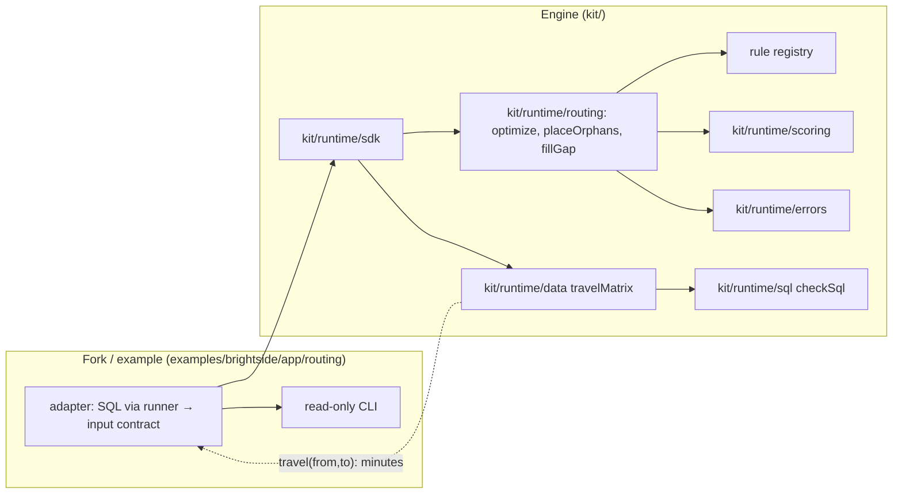

# Architecture Spine: AP Labs routing

Decisions only. Inherits `architecture-runtime.md` (AD-1 engine/fork boundary, AD-9 the only query runner, AD-16 optional profile keys, AD-17 typed errors, AD-18 fixture tooling) read-only. Every story in `epics-routing.md` builds against these rules.

## Design Paradigm

**Functional core, imperative shell.** `kit/runtime/routing` is a pure function library: typed input in, plan out, no I/O, clock, randomness or LLM. The shell (a client adapter in the app dir, plus `travelMatrix` in `kit/runtime/data`) reads data and builds the input.



Dependency rule: `kit/runtime/routing/**` may require only `kit/runtime/scoring`, `kit/runtime/errors` and its own files. It never requires `data`, `sql`, `llm`, `slack`, `connectors`, `store` or any `archetypes`, and never names `examples/` (grep test in `engine-boundary.test.js`). App code reaches routing and `travelMatrix` only through `kit/runtime/sdk` (runtime AD-1).

## Invariants & Rules

### AD-R1: The engine is pure and never reads client tables
- **Binds:** CAP-1, CAP-2, CAP-3, CAP-4
- **Prevents:** Brightside table names in the kit; nondeterminism from I/O or time.
- **Rule:** Three entry points: `optimizeDay(input, opts)`, `placeOrphans(input, opts)`, `fillGap(input, opts)`. Each takes the input contract (AD-R2) plus `{ travel, rules, budget }` and returns a plain object. No `Date.now`, no `Math.random`, no async, no `require` outside the dependency rule. Same input → byte-identical JSON output (test runs each entry point twice and compares).

### AD-R2: One input/output contract [ADOPTED: data-design §4]
- **Binds:** all
- **Prevents:** each adapter inventing a shape; coordinates or names reaching the engine.
- **Rule:** Input and output are exactly data-design §4, with these fixes: times are integer minutes after local midnight (wall clock, never UTC); ids are strings, ordered by `scoring.compareIds`; a stop's `rules` holds rule instances `{ ruleId, value, strength? }` (AD-R4); a time window is `{ startFrom, startBefore }` minutes (the adapter maps `morning`/`afternoon`); a node is a kind-prefixed id string (`property:<id>`, `crew:<id>`), never a coordinate; dates are ISO strings only, never a local `Date`. The adapter sets a crew `available: false` when its lead is absent or nobody is present (pending Dana Reyes's confirmation). Output rows carry ids, minutes and `reason` only. `contract.js` validates input and throws `RoutingFault` (AD-17, mapped in `messages.js`) naming the field; it never coerces.

### AD-R3: Travel is a port; the engine sees only minutes
- **Binds:** CAP-5
- **Prevents:** the solver computing distance itself; a maps connector needing a solver edit.
- **Rule:** The engine receives `travel(fromNode, toNode) → integer minutes`, synchronous, built by `travel.fromMatrix(rows)` over a prefetched rectangle (from-nodes × to-nodes). A missing pair throws `RoutingFault` (never 0). No return leg to base by default (data-design §6); `opts.returnToBase` turns it on. The V1 estimator is `travelMatrix` (AD-R9): haversine × `detour_factor` ÷ `speed_kmh`, rounded to 1e-6 then up to a whole minute, floored at `min_travel_minutes`. A later maps connector supplies the same matrix shape; nothing in `kit/runtime/routing` changes.

### AD-R4: Rules live in a registry; strength is per rule instance, default hard
- **Binds:** CAP-4
- **Prevents:** rule logic in the solver; a new rule needing an engine edit.
- **Rule:** A rule is `{ id, label, defaultStrength: 'hard'|'soft', weight (integer ≥ 1, soft only), check(stop, slot, ctx) → { ok, reason } }`, added with `createRegistry().register(rule)`, which validates the shape and refuses a duplicate id or a bad strength or weight. The solver loops over the registry and knows no rule by name. **Strength decision:** a stop's rule instance may carry `strength`; absent, the rule's `defaultStrength` applies. V1 rules and defaults: `crew-day-limits` (earliest start, latest finish; always hard, not overridable), `day-of-week` (hard), `time-of-day` (hard), `preferred-crew` (soft, weight 100), `aim-finish` (soft, minutes past `aimFinish`; 23:00 hard / 18:00 soft; scored in its own tuple position, AD-R5, never summed with preferred-crew). Brightside's `service_rules` rows are all hard for day and window (SQLsmith), so Brightside behaves as all-hard; the contract keeps the per-customer soft option for other clients.

### AD-R5: The objective is lexicographic, in integers
- **Binds:** CAP-1, CAP-2, constraints
- **Prevents:** a lower priority trading against a higher one; float drift breaking determinism.
- **Rule:** Compare plans by the tuple `(hardBreaks, softPenalty, driveMinutes, aimFinishMinutes, orderKey)`, all integers; `softPenalty` sums soft rules other than aim-finish. No returned plan has `hardBreaks > 0`: a stop that cannot be placed without a hard break goes to `unplaced[]` with a reason (test fixture `contradictory-rules.json`). `orderKey` is the concatenated stopId order, so ties always break by stopId.

### AD-R6: The solver is construction plus bounded local search
- **Binds:** CAP-1
- **Prevents:** run-to-run differences; an unbounded solve; a "better" plan worse than the booked one.
- **Rule:** Construction is cheapest feasible insertion in stopId order; improvement is relocate, swap and 2-opt within a crew, then relocate between crews of the same zone, first-improvement in a fixed move order. The time box is a **move-evaluation budget** (`budget`, default 20 000, from config), never wall clock, so slower machines give the same answer. Finally the result is compared with the booked order under AD-R5; if not strictly better, and only if the booked order breaks no hard rule, the booked order is returned with the reason "booked order is already best". Locked stops keep their crew and start. Optimize never moves a stop across zones. Quality bar: never worse than booked (every fixture test) and equal to the brute-force optimum on a ≤ 7-stop known-optimal test fixture.

### AD-R7: Route change places orphans by insertion cost; cross-zone is a recommendation only
- **Binds:** CAP-2, CAP-6
- **Prevents:** a broken day silently reshuffling other crews; a cross-zone move applied unseen.
- **Rule:** Orphans (stops of an unavailable crew) are taken hardest first (fewest feasible in-zone crews, then stopId) and inserted at the cheapest feasible position on a receiving crew. Receiving crews' existing stops keep their order; their starts may only shift within their own hard rules, and every shifted stop gets a `shifted[]` row "call to confirm the new time". If every crew is out, every stop goes to `unplaced[]` (test fixture `all-crews-out.json`). With no feasible in-zone slot, the cheapest cross-zone slot goes to `moves[]` with `crossZone: true, recommendation: true` and is not in any crew's plan. With none at all, the stop goes to `unplaced[]` with a plain reason ("call to rebook"); rescheduling to another day is out of scope.

### AD-R8: Gap fill filters on hard rules, then ranks with kit/runtime/scoring
- **Binds:** CAP-3
- **Prevents:** a second scoring formula; candidates that break a rule on the gap's slot.
- **Rule:** A gap runs from the previous stop's end (or the crew-day start) to the next stop's start (or the crew-day latest finish); adjacent cancellations merge into one gap. Candidates come only from `input.candidates` (the adapter's (gapDate, gapDate + 14] pull), never the property that cancelled and never a property already visited on the gap date; `prevVisitDate` is the latest non-cancelled visit from history or schedule. A candidate fits only if travel in + service + travel out fits inside the gap and no later stop shifts; it is kept when every hard rule passes in that slot and the move respects cadence (not closer than half its `cadenceDays` to `prevVisitDate`). A gap too small for every candidate returns an empty list with a reason. Several gaps on one crew may share a candidate: each row lists `alsoOfferedFor[]`, and the caller may pass `exclude[]`. Travel for ranking is the rectangle of the gap's two neighbours × the candidates. Survivors are ranked by `scoring.rank()` with an engine-declared spec (`row_id: stopId`; inputs: extra drive minutes (negative weight), flexible (0/1), days the visit moves up (negative), window fit (0/1)); weights default in the engine and may be overridden by `routing.gap_fill.weights`, checked by `checkScoring`. Top `limit` (default 5). `flexible` is a contract field the adapter sets; the engine never infers it.

### AD-R9: The only coordinate read path is travelMatrix
- **Binds:** CAP-5, CAP-7, constraints
- **Prevents:** coordinates reaching module SQL, logs, Slack or an LLM; a general "unforbid" switch.
- **Rule:** `travelMatrix(fromIds, toIds)` is built inside the `createData` closure (`kit/runtime/data/travel.js` holds the template), so it shares the guard, the 30 s timeout and redaction; the returned data object is frozen and a test asserts its exact keys (no override flag, no raw connection). It runs one static SQL template whose identifiers come from `routing.coordinates` and pass the identifier regex. Before running it checks that each declared coordinate column is INTEGER or BIGINT (declaring `street_address` is refused, with a test); every DuckDB error is wrapped in a fixed-text `RoutingFault`. It calls `checkSql` with the profile's forbidden list minus exactly the declared coordinate columns; every other forbidden column still applies. Profile validation refuses a `routing.coordinates` column that is not also in `sql.forbidden_columns`, or whose column type (checked at first use) is not INTEGER or BIGINT. The select list is fixed to `from_node, to_node, minutes` (INTEGER); node ids are kind-prefixed bound parameters; the rectangle is capped at `routing.max_pairs` (default 10 000) pairs. `run()` gains no option: a test proves `run()` still refuses a coordinate column and no other export can drop a forbidden column. Exposed to app code via `kit/runtime/sdk`.

### AD-R10: Profile changes are one optional `routing:` block [extends runtime AD-16]
- **Binds:** CAP-5, CAP-7
- **Prevents:** routing limits in code; unknown keys slipping past the schema.
- **Rule:** `profiles/_schema/profile.schema.json` gains `routing` (`additionalProperties: false`): `coordinates.nodes[]` `{ kind, table, id_column, lat_column, lon_column }` (micro-degree INTEGER), `speed_kmh`, `detour_factor`, `min_travel_minutes` (5), `max_pairs` (10 000), `limits` `{ earliest_start, default_start, aim_finish, latest_finish, slot_minutes }`, `gap_fill` `{ horizon_days: 14, limit: 5, weights? }`. Absent block = routing off. Defaults are filled in `validateProfile`, after the profile is hashed (the hash covers what the client wrote); no `schema_version` bump. An older kit rejects a `routing:` block (fork-guide note). Brightside's profile adds the four coordinate columns to `sql.forbidden_columns` (before the generator adds them) and a `routing` block with the generator's limits (06:00, 08:00, 18:00, 23:00, 15).

### AD-R11: Suggest only, explained, no coordinates out
- **Binds:** CAP-6, non-goals
- **Prevents:** a hidden write path; unexplained or location-leaking output.
- **Rule:** Routing has no write path and imports no connector (the write-path check covers it). Every output row has a `reason` built from rule labels, crew ids and minutes only. Output and reasons never contain a coordinate, street address or postal code (test scans the serialized output for the coordinate column values). No routing input or output is sent to the LLM.

## Consistency Conventions

| Concern | Convention |
| --- | --- |
| Naming | Engine files `kit/runtime/routing/{contract,travel,rules,optimize,change,gapfill,index}.js`; rule ids kebab-case; test files `test/unit/runtime-routing-*.test.js` |
| Data | Minutes are integers; dates ISO strings only (routing tests run under two TZ values across 2026-11-01); ISO day numbers (Mon = 1); route order renumbered 1..n without cancelled stops; never compare suggested and booked order by position |
| Errors | `RoutingFault` with a `problem` from a fixed list (AD-17) |
| Tests | Engine tests read synthetic inputs from `test/fixtures/routing/*.json` only; Brightside tests live under `examples/brightside/**` (runtime carve-out) |

## Structural Seed

```text
kit/runtime/routing/   contract.js travel.js rules.js optimize.js change.js gapfill.js index.js
kit/runtime/data/travel.js            # travelMatrix (AD-R9)
test/fixtures/routing/                # synthetic days: small, known-optimal, contradictory-rules, sick-crew, all-crews-out, gap, cross-zone
examples/brightside/app/routing/      # adapter.js, *.sql, cli.js, __tests__/
examples/brightside/fixture/lib/routing.js  # stream 'routing', S1–S3 planting
```

## Capability → Architecture Map

| Capability | Lives in | Governed by |
| --- | --- | --- |
| CAP-1 optimize | `routing/optimize.js` | AD-R1, R5, R6 |
| CAP-2 orphans | `routing/change.js` | AD-R7 |
| CAP-3 gap fill | `routing/gapfill.js`, `kit/runtime/scoring` | AD-R8 |
| CAP-4 rules | `routing/rules.js` | AD-R4 |
| CAP-5 travel | `routing/travel.js`, `data/travel.js` | AD-R3, R9 |
| CAP-6 reasons, cross-zone | all entry points | AD-R7, R11 |
| CAP-7 fixture, truths | `examples/brightside/fixture`, `profiles/brightside` | AD-R10, data-design §1, §5 |

## Computed tiers

`APLABS_PROFILE=$PWD/profiles/brightside/profile.yml node kit/lib/tier <paths>` on each story's planned paths (2026-10-26):

| Epic | Tier | Raised by |
| --- | --- | --- |
| 12 | T1 computed, **T2 declared** | computed T1 today; 13.3 adds `kit/runtime/routing/**` to Brightside's T2 row, so Epic 12 runs at a declared T2 (resolution e) |
| 13 | T3 | `profiles/_schema/**`, `kit/lib/profile/**` (13.1); `kit/runtime/data/**` engine floor (13.2); `profiles/**` incl. `context/guardrails.md` (13.3) |
| 14 | T3 | `profiles/brightside/context/data.md` via `profiles/**` (14.4); 14.1 computes T1, treated as T2 (coordinates enter the data); 14.2, 14.3, 14.5 T1 |

Data-design §3 now records `travelMatrix` as T3 (engine floor). `kit/runtime/routing/**` matches no tier row until 13.3 adds it at T2.

## Deferred

- **Maps connector** (real road times): same matrix shape, a connector story when a client needs it.
- **Slack UX, access key, hub wiring**: after the Brightside CLI proves the engine.
- **Rescheduling to another day, multi-day re-plan, skills or equipment matching, live traffic.**
- **Re-sequencing receiving crews on a route change**: V1 inserts only (AD-R7).
- **Approve-and-push** to a scheduling system: needs the approval-write archetype and a connector.
