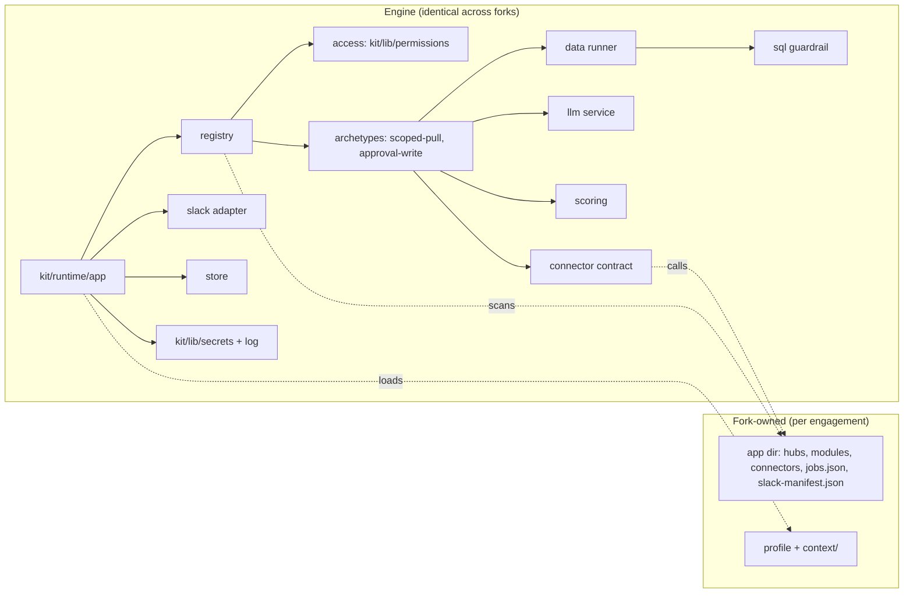
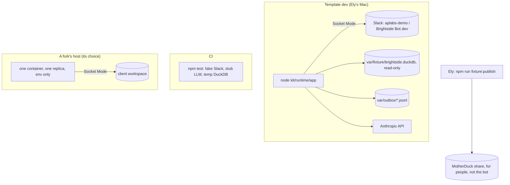

# Architecture Spine: AP Labs runtime

Decisions only; the rationale for each is in the spec memlog (`../specs/spec-runtime/.memlog.md`, round 2). Every story in `epics-runtime.md` builds against these rules.

## Design Paradigm

**Ports and adapters, one process.** The engine core (registry, access, archetypes, scoring, store) talks to the outside world only through ports. Each port has one adapter in V1.

| Port | V1 adapter | Lives in |
| --- | --- | --- |
| Surface (receive commands/actions, reply privately) | Slack Bolt, Socket Mode | `kit/runtime/slack/` |
| Data (run one read-only query) | DuckDB local file | `kit/runtime/data/` |
| LLM (one structured extraction) | Anthropic SDK | `kit/runtime/llm/` |
| Connector (read / write an external system) | in-process mocks writing an outbox | contract `kit/runtime/connectors/`; adapters in the app dir |
| Store (TTL key/value) | in-memory | `kit/runtime/store/` |

**Engine vs fork.** The engine is code we fix once for every engagement. A fork adds data (profile, hubs, manifests) and small per-module files (handler, SQL template, connector adapter).



Dependency rule: arrows point inward only. Engine code never `require`s or names a path inside the app dir or `examples/`; it reaches fork files only through discovery (AD-3) and the connector contract (AD-15). Module handlers and connector adapters may import only `kit/runtime/sdk` (the handler-facing surface: reply, runner, store, llm, connectors), never any other `kit/` path. Both directions are grep tests (Story 6.5).

## Invariants & Rules

### AD-1: The engine/fork boundary is a path list

- **Binds:** CAP-3, CAP-15, NFR12
- **Prevents:** Brightside code leaking into the engine; "engine files identical" being untestable.
- **Rule:** The **identical-engine set** is `kit/**` and `profiles/_schema/**`: byte-identical in every fork, exported as one constant (`kit/runtime/paths.js`) and asserted by Story 11.3. Template-owned but fork-editable: `package.json` and `package-lock.json` (a fork may append dependencies, never change or remove an engine one; the fork guide says so), `Dockerfile`, `.dockerignore`, `scripts/**` and engine tests under `test/**`. Fork-owned paths are the profile, its `context/`, and the app dir. In the template, all Brightside runtime examples live in `examples/brightside/` (`app/` and `fixture/`); its profile and context stay at `profiles/brightside/` (Orchestrator canon). The fork guide deletes both.
- **Imports:** nothing under the app dir imports from `kit/` except `kit/runtime/sdk`, and no engine file references `examples/`; Story 6.5 adds both grep tests.
- **Trust:** handler and connector code in the app dir is trusted, reviewed code (it goes through the build loop and review like engine code). It is **not sandboxed**: it runs in the same process and can reach `process.env`. The protection against an LLM or a request reaching secrets is that the LLM has no tools (AD-11) and every output passes the redacting logger (AD-12), not isolation of handler code.

### AD-2: The profile is found by path, never by a template-repo `.aplabs/`

- **Binds:** CAP-1, CAP-4, CAP-5 [ADOPTED: kit/lib/profile, kit/lib/onboard]
- **Prevents:** the template becoming a governed repo by accident; context read from two places.
- **Rule:** The runtime calls `loadProfile()` from `kit/lib/profile`. In template dev and the container, `APLABS_PROFILE` holds an absolute path (template dev: `profiles/brightside/profile.yml`). In a fork it falls back to `.aplabs/profile.yml`. Never add `.aplabs/profile.yml` to the template repo. Context files come only from `contextDirFor(profilePath)` (`kit/lib/onboard`). The app dir comes from `APLABS_APP_DIR` (absolute; default `<repo>/app`; template dev: `examples/brightside/app`).

### AD-3: Modules and hubs are discovered by directory scan

- **Binds:** CAP-2, CAP-3
- **Prevents:** a registration file every builder edits; hub-specific code.
- **Rule:** At boot the registry reads `<app>/hubs/*.json` and `<app>/modules/*/manifest.json`, sorted by file name. Nothing else registers a module. A module's handler, SQL template and test sit in its own folder. Adding a module or a hub entry is data plus files in that folder; adding a hub is data plus `npm run slack:manifest` (AD-5).

### AD-4: Manifests are JSON, validated by ajv like the profile

- **Binds:** CAP-3, CAP-9, CAP-10
- **Prevents:** two manifest dialects; config that executes on load.
- **Rule:** `kit/runtime/schema/hub.schema.json` and `module.schema.json` (JSON Schema 2020-12, `additionalProperties: false`), checked with the repo's pinned ajv. A module manifest declares `id`, `hub`, `label`, `description`, `resource`, `archetype` (`handler`, `scoped-pull` or `approval-write`), `environments`, and per archetype: `handler`, `parameters[]` (name, type, enum or min/max, default, required), `query` (a `.sql` file), `row_id` (the column that tells rows apart; required with `scoring`), `scoring` (`inputs[]`: name, label, weight, min, max; `limit_parameter`: the integer input kept after scoring, never bound; the SQL ends `ORDER BY …, <row_id> LIMIT 5001`), `write` (connector, operation, destination, `fields`: the push fields copied into the approval entry, AD-15). Boot and a `npm test` check both fail naming the module file and the field. Unknown resource keys are a config fault, not a denial.

### AD-5: One runtime Slack app per fork, Socket Mode, separate from notify

- **Binds:** CAP-1, CAP-2, CAP-11
- **Prevents:** sharing credentials with `npm run notify`; scope creep; manifest drift.
- **Rule:** The runtime is its own Slack app (template dev: "Brightside Bot (dev)" in the existing `aplabs-demo` workspace). It never reuses the "AP Labs Orchestrator" webhook app. Env: `SLACK_BOT_TOKEN` (xoxb-) and `SLACK_APP_TOKEN` (xapp-, `connections:write`); no signing secret in Socket Mode. Bot scopes are exactly `commands`, `chat:write`, `im:write`, `im:history`, `files:write`, `users:read`; adding one needs an Architect review. The app manifest (`<app>/slack-manifest.json`) is generated from the hub files by `npm run slack:manifest`; a test fails when the committed file differs.

### AD-6: Acknowledge first, then work

- **Binds:** CAP-1, CAP-2, CAP-9, CAP-10
- **Prevents:** Slack timeouts and retries producing double work; silent failures.
- **Rule:** One wrapper (`kit/runtime/slack/handle.js`) registers every command, action and view handler. It calls `ack()` before any work (within 3 s), runs the work asynchronously, and replies via `respond()`/`response_url` or an ephemeral or DM post. Any error after the ack is caught and turned into a plain message to the same person. Events are de-duplicated on `event_id` in the store's `event` namespace for 10 minutes, so a retried delivery (`retry_attempt` / `x-slack-retry-num`) is processed once.

### AD-7: One store interface for all short-lived state

- **Binds:** CAP-9, CAP-10, CAP-11
- **Prevents:** five hand-rolled caches with different expiry and race behaviour.
- **Rule:** `kit/runtime/store` exports `createStore({ now })` with synchronous `get(ns, key)`, `set(ns, key, value, ttlMs)`, `consume(ns, key)` and `done(ns, key)`. `consume` gets and deletes in one synchronous call and, in the same call, leaves a `done` marker for that key (`{ state: "running" }`); the caller later records the outcome with `finish(ns, key, result)`. A second click finds no entry, reads `done(ns, key)`, and is told "already done" with the result (or "already running"). No `await` between a check and a `consume`. Tests inject the clock.
- **Namespaces and TTLs** (every namespace has one; `set` rejects a namespace not in this table):

  | Namespace | Key | TTL | Holds |
  | --- | --- | --- | --- |
  | `welcome` | person + hub | 7 days | first-visit flag |
  | `session` | session id (carried in the button), bound to the person | 30 min, refreshed on activity | a scoped-pull's parameters and state |
  | `provenance` | run id | 24 h | the run record (AD-15) for "How was this made?" only |
  | `approval` | token | 30 min | the approval entry, including its own copy of the rows to push (AD-15) |
  | `done` | `<ns>:<key>` of a consumed entry | 10 min | `running` or the outcome, for "already done" |
  | `event` | Slack `event_id` | 10 min | de-duplication (AD-6) |
  | `escalation` | module + reason | 15 min | suppression window (10.3) |
  | `ratelimit` | person | 1 h window | LLM calls counted (AD-11) |

- **Sessions** are keyed by a session id (128-bit, CSPRNG) carried in the Confirm/Change buttons and bound to the person; a click from anyone else is refused. Keying by person + module is not used: one person can hold two sessions on the same module without them colliding.

### AD-8: One replica only

- **Binds:** CAP-1, CAP-10, Story 11.2
- **Prevents:** split sessions and double-processed actions across instances.
- **Rule:** Because the store is in memory, a deployment runs exactly one process. The container doc, the fork guide and the startup log say so. Deploys are **stop-then-start, never rolling**: an old and a new process never run side by side (two Socket Mode connections would split events and each hold its own store). The container doc names the host setting for this (for example "recreate" rather than "rolling update" strategy) and accepts the brief gap. A durable store is deferred.

### AD-9: The query runner is the only way SQL runs

- **Binds:** CAP-8, CAP-9, CAP-13, NFR8
- **Prevents:** a module opening its own connection; DuckDB reading files, the network or env.
- **Rule:** `kit/runtime/data` exports the only runner: `run(sql, params)`. Every call passes `kit/runtime/sql` guardrails first (a test spies on it). Only `kit/runtime/data` and the offline fixture builder (`kit/fixture/build.js`, the one writer, never loaded by the app) may import `@duckdb/node-api`; a test greps for violations. The runtime opens the local file with `access_mode=READ_ONLY`, `enable_external_access=false`, `autoinstall_known_extensions=false`, `autoload_known_extensions=false`, then `lock_configuration=true`. The data source is the local fixture file (`APLABS_DATA_PATH`) by default; a profile with `data.source: motherduck` reads the one MotherDuck database `data.database` instead (plan motherduck-read, DEP-011 closed), with the bot's own read key (`MOTHERDUCK_READ_TOKEN`, refused if it equals the publish key) and the lockdown `MD_LOCKDOWN` in `kit/runtime/data/motherduck.js`: an in-memory instance with extension auto-install and auto-load off; then `LOAD motherduck`, `SET motherduck_token`, `SET motherduck_attach_mode = 'single'`, `ATTACH 'md:<db>' AS <db> (READ_ONLY)`, `SET enable_external_access = false`, `SET lock_configuration = true`; then `USE <db>` on every connection, and one check at open that `current_database()` is `<db>` and holds `fixture_meta`. The `md:<db>?attach_mode=single` path form is not used: with external access off it cannot open, and without it the server ran a URL read (live check, 2026-10-24). Only `<db>`, `md_information_schema` and the in-process `memory` scratch database are visible; the reader's own `my_db` can still be attached by name, an exception Ely accepted on 2026-10-24 because the SQL guardrail refuses ATTACH (Story A). Connecting has a 10s limit and never blocks Slack startup; every query has a 30s limit (`conn.interrupt()`); every DuckDB error becomes data unavailable, and anything but a catalog or binder error drops the instance and waits 30s before reconnecting. There is no fallback to the local file. The extension is installed ahead of time, never by the bot (DEP-016).
- **Threat model:** in V1 every query is a reviewed static template (AD-10); no person and no LLM writes SQL. The guardrail is defence in depth behind that and behind the locked DuckDB settings, not the only line. It still fails closed on anything it can't classify.
- **Guardrail rules (DuckDB-specific):** block every table-function call not on an allowlist (V1 allowlist: empty), which covers the file, network and env readers and, named explicitly with a test each, `query(`, `query_table(` and `json_execute_serialized_sql`; block a quoted path or URL used as a table; block `COLUMNS(`; and while any forbidden column is configured, block a wildcard (`*`, `t.*`, `"t".*`, `* EXCLUDE`/`REPLACE`) and a table name or alias used as a value in the select list (DuckDB turns it into a struct of the whole row). Each bypass has its own test.

### AD-10: The LLM fills declared parameters; SQL is never built from text

- **Binds:** CAP-5, CAP-8, CAP-9
- **Prevents:** SQL injection through the LLM; data leaking to the model.
- **Rule:** A module's SQL is a static template file with named placeholders (`$zone`, `$lapsed_days`, `$limit`), bound as prepared-statement parameters. String interpolation into SQL is forbidden (the runner rejects a parameter not declared in the manifest; a test checks templates contain no `${`). The LLM returns values only for the manifest's declared parameters; each is validated against its declaration before binding. Every module template passes the guardrail at boot; a failing template stops boot naming the module. Query rows are never sent to the LLM.

### AD-11: The LLM service is isolated and capped

- **Binds:** CAP-5, NFR11
- **Prevents:** an LLM path that can read data, write externally or run up a bill.
- **Rule:** `kit/runtime/llm` is the only caller of the Anthropic SDK. V1 makes one structured extraction call per request (no tool loop). Any tool registered must declare `effects: "none"`; the registry rejects anything else, so no LLM-callable tool can run SQL or a connector write. Every call: kill switch (`APLABS_LLM_OFF`) checked first, then the per-person rate limit (store `ratelimit`), then the hourly breaker (per process, resets on restart; the console spend cap backs it), with per-call `max_tokens` and a timeout. Cost uses a per-model price table in code; a test fails if the configured model has no price. Context sent to the model is a declared list in code: `org.md` and `data.md` from `contextDirFor(profilePath)`; `guardrails.md` and `connectors.md` are never sent. Before sending, the loader **strips YAML frontmatter and every fenced `truth` block** from each file (chosen over sending only the client name and parameter declarations, because CAP-5 asks for declared context files; the stripping keeps truth SQL and expected figures away from the model). A test asserts no truth block content reaches the prompt. When the LLM is off or refused, the module falls back to its typed form.
- **Breaker accounting:** at check time the breaker reserves the worst-case cost of the call (`max_tokens` × the model's output price, plus the input tokens × input price) against the hourly limit, so concurrent calls cannot overshoot it; the reservation is replaced by the actual cost when the reply arrives. It fails closed (plan epic-9): input is estimated at characters ÷ 3 tokens; a call that errors or times out, or a reply with no usage figures, stays at worst case, never 0; the SDK never retries (`maxRetries: 0`) and has a 20 s limit.

### AD-12: Secrets come through one library and never reach output

- **Binds:** CAP-1, CAP-5, NFR5 [planned shared library, approved with this plan]
- **Prevents:** each block reading env and the Keychain its own way; tokens in logs.
- **Rule:** Story 6.1 extracts the env-then-Keychain read and `redact()` from `kit/lib/notify` into `kit/lib/secrets` (notify keeps its behaviour and tests). `readSecret(envName, keychainService)` reads env first; the Keychain only on macOS and never when `APLABS_NO_KEYCHAIN=1` (the container sets it: env only). Every secret read is registered with `kit/runtime/log`, which redacts all registered values from every line. Startup errors name the missing variable, never a value. Secret env var names live in code or the manifest, never the profile. **Connectors read env only:** a connector's credentials (`auth.env`) are read with no Keychain fallback (`readSecret(name, null, { env })`), so a connector behaves the same on a laptop and in the container, and a missing credential fails closed naming the variable. A connector must be created with the app's logger (`create({ log })`), so every credential it reads, and every token `connect` obtains and passes to `registerSecret`, registers with it.
- **Library logs:** the app passes a custom logger to Bolt and the Slack SDK so their output goes through `kit/runtime/log` at INFO and above; DEBUG is dropped (at debug level the SDK prints the Socket Mode connection URL, which carries a ticket). A test sets the library to debug and asserts no line reaches the output unredacted.

### AD-13: Health is a tiny listener, on only when asked

- **Binds:** CAP-1, Story 11.2
- **Prevents:** a host that can't tell a dead Socket Mode app from a live one.
- **Rule:** When `APLABS_HEALTH_PORT` is set, the app serves `GET /healthz`. It returns 200 during a boot grace period (90 s from start) and while the Socket Mode connection is open; it returns 503 only after the connection has been down for more than 60 s continuously, so a normal reconnect never fails the check. No other route. Off by default in dev.

### AD-14: Private by default; one declared channel exception

- **Binds:** CAP-9, CAP-10, CAP-11, NFR3
- **Prevents:** rows posted to a channel; files shared where others can read them.
- **Rule:** Replies are ephemeral or DM. Files go only to the person's DM (`conversations.open`, then upload to that DM channel); the ephemeral reply links to it. Channel posts go through one function that accepts only entries in a declared exception list. V1 has one exception: the write escalation to the profile's `slack.ops_channel`, carrying module, reason and counts only, never row data.

### AD-15: Writes go through the approval archetype and the connector contract

- **Binds:** CAP-6, CAP-7, CAP-10
- **Prevents:** a module writing directly; double pushes; replayed approvals.
- **Rule:** Only `kit/runtime/archetypes/approval-write` calls a connector write operation. `kit/verify/write-path.js` (DEP-012) enforces it, run by `npm run check` (through `scripts/check-write-path.js`), by `npm test`, and by the engine itself as the built-in verify check `engine:write-path` in every `npm run verify` and the end-of-turn hook, which no profile setting removes; extra app dirs (the template's example clients) come from `package.json` `aplabs.appDirs`, so the engine names none: outside that folder, `kit/runtime/connectors/**` and each connector's own folder (`<app dir>/connectors/<id>/**`, `kit/templates/connector/**`; a loose file in `connectors/` is scanned), app code, the templates and `kit/runtime/**` may not mention `dryRun` other than `dryRun: true`, reach or alias a connector's `write` operations, create a connector instance or declare a connector; the failure names the file and line. In a governed repo, finding no app dir fails the check, as does an `APLABS_APP_DIR` that doesn't exist. A connector's in-memory idempotency store is one per connector per process, shared by every instance it creates (in-flight writes too), and every stored slot names the connector (`<id>\u0000<operation>\u0000<key>`), so a second `create()` cannot re-apply a key and one store can serve several connectors. A live batched write saves its progress record (counts, flags and id-shaped refs only, bound to the input fingerprint and batch size, beside its slot) after every completed request, before the next is sent, so a crash or redeploy mid-push leaves an accurate record and a retry with the same key and input resumes after what went; a failed save stops the write before its next request (`details.sent.recorded: false`), a `perItemIdempotency` write that ends in `PartialFailure` overwrites its record with `completed: []` so its retry calls every request, and the guarantee holds only with a durable idempotency store (10.0, DEP-017). A connector adapter exports the contract in `kit/runtime/connectors/contract.js` (auth env names, read and write operations, dry-run, idempotency key, kill-switch env name, rate limit). Approve order: look up the token (`get`); if it is gone, read `done` and reply "already done" with the result, else the generic "no longer valid" reply; check the person matches, else the same generic reply; check the connector and global kill switches, refusing without consuming; then `consume` synchronously, push, and `finish` with the counts.
- **Where the pushed rows come from:** the pull's run record (store `provenance`, keyed by run id, 24 h) is `{ runId, person, module, parameters, sql, source, fixtureVersion, ranAt, rowIds, rows }`, where `rows` holds, per scored row, only the module's declared push fields (Win-back: `client_id`, `email`, `first_name`, `score`) and is present only for a module with a write. At preview time the archetype **copies** the approved rows' push fields into the `approval` entry: `{ person, runId, destination, listName, rows, idempotencyKey }`. The push reads **only** that entry, never `provenance` and never the button, so `provenance` expiring cannot break a push; `provenance` serves only the "How was this made?" button. If `provenance` has already expired when the person clicks Push, the preview says the results expired and to run the pull again.
- **Token:** 128-bit CSPRNG, bound to person, row set and destination, TTL 30 minutes (AD-7).
- **Idempotency key** = sha256 of the sorted approved row ids plus the destination list name, and the list name includes the run date (UTC, for example `win-back-north-2026-10-24`), so the same list re-sent on a later day creates a new list while a same-day replay writes nothing. Mock outboxes write under `var/outbox/` (`APLABS_VAR_DIR`, gitignored, outside `.aplabs/`); the fixture is never written.

### AD-16: New profile keys, all optional

- **Binds:** NFR4 [ADOPTED: kit/lib/profile]
- **Prevents:** keys added ad hoc; secrets in the profile.
- **Rule:** Each key lands with its story, in `profiles/_schema/profile.schema.json` (`additionalProperties: false`), with defaults filled in `validateProfile`:

  | Key | Shape | Default | Story |
  | --- | --- | --- | --- |
  | `users[].identities.slack` | existing; now unique across users (validation error on duplicates) | — | 6.3 |
  | `sql.forbidden_columns` | array of `"table.column"` strings, unique | `[]` | 7.4 |
  | `llm.model` | string, must be in the price table | in code | 9.1 |
  | `llm.extraction_model` | string, must be in the price table | in code | 9.1 |
  | `llm.hourly_usd_limit` | number > 0 | 2 | 9.1 |
  | `llm.max_tokens` | integer 1–8192 | 1024 | 9.1 |
  | `slack.ops_channel` | channel id string | none: escalation logs only | 10.3 |
  | `jobs.enabled` | boolean; a job runs only with this, its own `enabled` in `jobs.json`, and no `APLABS_JOBS_OFF` [ADOPTED: kit/runtime/jobs] | false | 11.1 |

  An `approval-write` module's resource must be declared `admin_grantable: false` in the profile, or boot refuses it (Story 10.2). `kit/lib/permissions` is unchanged.

### AD-17: One place turns errors into words

- **Binds:** CAP-4, CAP-9, CAP-10, UX-DR2
- **Prevents:** each module inventing its refusal wording; a config fault shown as a denial.
- **Rule:** Engine code throws typed errors (`NotSetUp`, `AccessDenied`, `ConfigFault`, `GuardrailBlocked`, `DataUnavailable`, `LlmUnavailable`, `SessionExpired`, `PreviewInvalid`, `KillSwitchOn`, `ConnectorFailed`, `ConnectorAuthFailed`, `IdempotencyConflict`, `PartialFailure`). `kit/runtime/messages.js` maps each to one plain message with a next step. `ConnectorFailed` is the outage message ("try again later"). A connector auth failure has two messages: a credential that is not set is a setup fault (`details.setup`, worded like `ConfigFault` and pointing at the admin), and a credential the system rejected says so; neither reads as a passing outage. A `PartialFailure` states its counts honestly and promises nothing it can't keep: by default "Sent 97 of 100 to X; 3 failed. Please tell your admin before trying again."; only a write that declares `perItemIdempotency: true` (`details.retrySafe`) gets "Nothing was sent twice, so trying again is safe", which holds only when the retry reuses the same idempotency key and input (DEP-013). Its text is rebuilt from the counts, and its `failedRefs` (id-shaped, else masked) go to the log only, never to the person. `messageFor(err, { admin })` names the admin when the caller knows it. Handlers never build refusal text themselves.

### AD-18: Fixture tooling is offline and separate from the runtime

- **Binds:** CAP-13
- **Prevents:** the app writing the fixture; network in CI.
- **Rule:** Brightside's generator, schema and seed files live in `examples/brightside/fixture/`. The generic tools live in `kit/fixture/`: `build` (the only DuckDB writer, to `var/fixture/<client>.duckdb`), `validate` (runs each `checks/*.sql`, which must return zero rows), `status` and `publish`. `publish` and `status --remote` read the MotherDuck token through `kit/lib/secrets` and are run by Ely only. Known truths are `truth` blocks in the client's `context/data.md`, run by `kit/lib/truths` through `npm run verify`; their `run` commands go through the query runner.

## Consistency Conventions

| Concern | Convention |
| --- | --- |
| Naming | Module ids and folders are kebab-case slugs; resource keys UPPER_SNAKE (existing schema); action ids `<module-id>:<verb>`; store namespaces as in AD-7 |
| Data and formats | Money in integer cents; dates ISO `DATE`; timestamps UTC; "now" in data queries is the fixture's `as_of`, never `CURRENT_DATE` |
| Config | Profile for who/what (no secrets); env for secrets and paths (`APLABS_PROFILE`, `APLABS_APP_DIR`, `APLABS_DATA_PATH`, `APLABS_VAR_DIR`, `APLABS_HEALTH_PORT`, `APLABS_LLM_OFF`, `APLABS_WRITES_OFF` (global write kill switch), `APLABS_JOBS_OFF` (every scheduled job off; any non-empty value, including "0"), `APLABS_NO_KEYCHAIN`); env var names for secrets in code or manifests |
| Logging | `kit/runtime/log` only, one JSON line per event, secrets redacted; never log query rows, prompts or LLM replies |
| Errors | Typed errors (AD-17); exit non-zero at boot listing every problem at once |
| Tests | `node:test`, offline: fake Slack client, stub LLM, temp DuckDB per test from seed files, injected clock. Engine tests under `test/**` read client specifics from `test/fixtures/`, never `profiles/brightside/` or `examples/brightside/`. Carve-out: example tests under `examples/brightside/**` may use Brightside's profile and data; they are deleted with the example in a fork |
| Dependencies | Exact pins with a one-line reason each (PLAN §3) |

## Stack

| Name | Version |
| --- | --- |
| Node | 24 LTS (repo engine, `engines.node >=24`) |
| ajv | 8.20.0 (existing pin) |
| yaml | 2.9.1 (existing pin) |
| @slack/bolt | 5.1.0 (Story 6.1: current release on 2026-10-24; Socket Mode app framework, brings `@slack/socket-mode` and `@slack/web-api`) |
| @duckdb/node-api | 1.5.6-r.2 (Story 7.3: newest 1.x release on 2026-10-24; official DuckDB client with prebuilt platform packages, so no native build. 2.0.0-r.1 (2026-10-21) is a new major: adopt it once Story 7.7 confirms MotherDuck accepts DuckDB 2.0 files) |
| @anthropic-ai/sdk | 1.3.0 (Story 9.1: newest release on npm on 2026-10-25; the official Anthropic client, loaded only by `kit/runtime/llm`. Built with `maxRetries: 0`, a 20 s timeout, the API's base URL and OpenTelemetry off, so no env var can redirect the key or trace a request) |

Planning ran with no network, so new versions are not pinned here; each story verifies the current release and pins it exactly.

## Structural Seed

```text
kit/
  lib/secrets/              # env then Keychain, redact (extracted from notify, 6.1)
  runtime/
    app/                    # boot, env check, health listener
    paths.js                # engine path list (AD-1)
    sdk.js                  # what module handlers may import
    log.js  messages.js     # redacting logger; error → words
    schema/                 # hub.schema.json, module.schema.json
    registry/               # discovery, menus, dispatch
    access/                 # wraps kit/lib/permissions + slack identity
    store/                  # TTL store (AD-7)
    slack/                  # handle wrapper, format, chunk, thread, provenance, manifest generator
    sql/                    # guardrail tokenizer + denylist
    data/                   # the only query runner
    llm/                    # the only Anthropic caller, breaker, prices
    connectors/             # contract + shared contract test suite
    archetypes/scoped-pull/  archetypes/approval-write/
    scoring/  jobs/
  fixture/                  # build, validate, status, publish CLIs
  templates/module/  templates/connector/   # copied by builders
  templates/context/connectors.md           # extended in 8.1
examples/brightside/
  app/hubs/  app/modules/<id>/  app/connectors/{crm,email}/  app/slack-manifest.json
  fixture/generate.js  fixture/schema.sql  fixture/seeds/*.csv  fixture/checks/*.sql  fixture/truths/*.sql
profiles/brightside/profile.yml  profiles/brightside/context/data.md
var/                        # gitignored: fixture db, outbox
```



## Capability → Architecture Map

| Capability | Lives in | Governed by |
| --- | --- | --- |
| CAP-1 boot | `kit/runtime/app`, `kit/lib/secrets` | AD-2, AD-5, AD-6, AD-12, AD-13 |
| CAP-2 hubs | `kit/runtime/registry`, `<app>/hubs` | AD-3, AD-5 |
| CAP-3 module contract | `kit/runtime/schema`, `kit/templates/module` | AD-1, AD-3, AD-4 |
| CAP-4 access | `kit/runtime/access`, `kit/lib/permissions` | AD-2, AD-16, AD-17 |
| CAP-5 LLM | `kit/runtime/llm` | AD-10, AD-11 |
| CAP-6 connector contract | `kit/runtime/connectors` | AD-15 |
| CAP-7 mocks | `examples/brightside/app/connectors` | AD-15, `connector-review.md` |
| CAP-8 guardrails | `kit/runtime/sql`, `kit/runtime/data` | AD-9, AD-10 |
| CAP-9 scoped pull | `kit/runtime/archetypes/scoped-pull` | AD-6, AD-7, AD-10, AD-14 |
| CAP-10 approval write | `kit/runtime/archetypes/approval-write` | AD-7, AD-14, AD-15 |
| CAP-11 Slack basics | `kit/runtime/slack`, `kit/runtime/store` | AD-6, AD-7, AD-14 |
| CAP-12 jobs | `kit/runtime/jobs` (UTC five-field cron, read-only `ctx`: log, data, now, name), `kit/runtime/schema/jobs.schema.json`, `<app>/jobs.json`, `<app>/jobs/`, `kit/templates/job.md` [ADOPTED: Story 11.1] | AD-16 |
| CAP-13 fixture | `kit/fixture`, `examples/brightside/fixture` | AD-9, AD-18 |
| CAP-14 demo | Brightside example modules | all |
| CAP-15 forks | `kit/runtime/paths.js` (the identical-engine set), `kit/lib/fork` (what may differ between forks: `compareForks`, `packageDelta`), `test/acceptance/two-forks.test.js` | AD-1, AD-2 |

## Computed tiers

**Change the profile, not the tool.** Story 6.1 (the first story) adds these rows to `profiles/brightside/profile.yml` `tiers`, so the runtime's risky paths floor where they belong:

| Tier | Added paths |
| --- | --- |
| T3 | `kit/runtime/archetypes/approval-write/**`, `kit/runtime/connectors/**`, `kit/lib/secrets/**` |
| T2 | `kit/runtime/sql/**`, `kit/runtime/data/**`, `kit/runtime/llm/**` |

Tiers below were computed with `APLABS_PROFILE=<temp copy of the profile with these rows> node kit/lib/tier <paths…>` on each story's planned paths (the temp copy is not committed):

| Epic | Tier | Raised by |
| --- | --- | --- |
| 6 | T3 | `kit/lib/secrets/**` (6.1) |
| 7 | T2 | `.github/workflows/**` (7.1), `kit/runtime/sql/**` (7.4), `kit/runtime/data/**` (7.5) |
| 8 | T3 | `kit/runtime/connectors/**` (8.1) |
| 9 | T3 | `profiles/**` and `kit/lib/profile/**` (9.1), `kit/runtime/llm/**` (an engine T3 floor since 9.1, plan epic-9 decision 4), Brightside resource rows (9.3, 9.5, 9.7) |
| 10 | T3 | `kit/runtime/archetypes/approval-write/**` (10.2, 10.3) |
| 11 | T2 | `Dockerfile`, `.github/workflows/**` (11.2) |

Per story: T3: 6.1, 8.1, 10.2, 10.3. T2: 7.1, 7.4, 7.5, 9.1, 11.2. T1: the other 20. **Recomputed for Epic 9 (plan epic-9, 2026-10-25):** 9.1, 9.3, 9.4, 9.5 and 9.7 are T3; 9.2 and 9.6 are T1. Since #115 and 9.1, `kit/runtime/data/**`, `kit/runtime/sql/**`, `kit/runtime/llm/**`, `kit/lib/secrets/**` and `kit/lib/profile/**` are engine T3 floors (`ENGINE_T3` in `kit/lib/tier`), whatever the profile rows above say. The Brightside mock adapters (8.2, 8.3) live in `examples/brightside/app/connectors/`, which these rows don't cover; they compute T1 (mock, outbox only). A fork's profile should tier its own `app/connectors/**` at T3 (fork guide, 11.4). The whole phase still sits behind one plan gate (`approve plan runtime-phase`); per-story tiers set each story's review ceremony inside it.

## Deferred

- **The runtime reading MotherDuck.** Done (plan motherduck-read, DEP-011 closed): `data.source: motherduck` with the bot's own read key, see AD-9. Still deferred: a fallback to the local file when MotherDuck is down (V1 says "data unavailable"), a compute-cost cap, and DuckDB 2.0 (waits on MotherDuck support).
- **Durable store and more than one replica.** Revisit when a fork needs zero-downtime deploys or more than one instance.
- **HTTP (Events API) mode.** A fork deploy choice; it would add a signing secret and a public URL.
- **A tool loop for the LLM.** Revisit only with a new archetype that needs it; AD-11 still applies.
- **Thread context to the LLM.** Converting a thread's messages into LLM messages is cut from V1 (Story 9.2 keeps formatting and chunking only): a thread can hold result rows, and NFR9 says rows never reach the LLM. Revisit with the tool loop, with a filter that drops bot result messages.
- **Production hosting.** Each fork chooses; the template ships a generic container (11.2).
- **Exact dependency versions.** Pinned by the story that adds each dependency.
