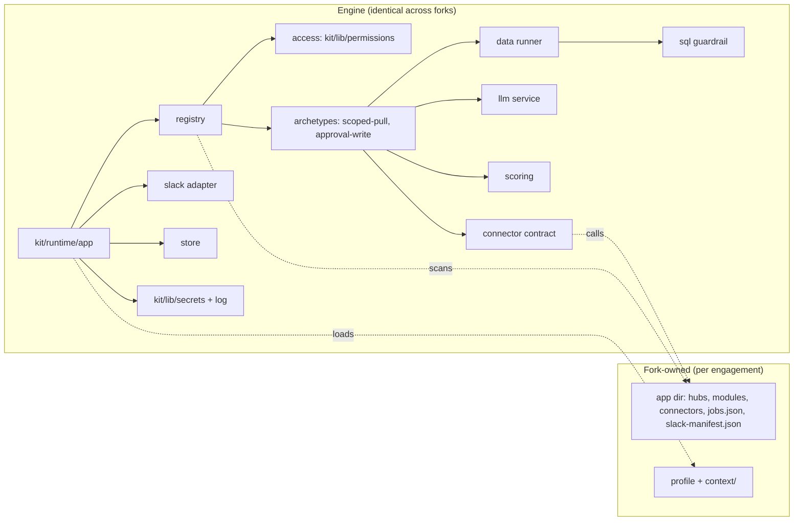
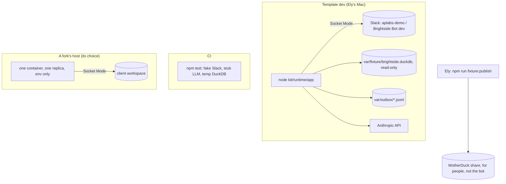

# Architecture Spine: AP Labs runtime

Decisions only; the rationale for each is in the spec memlog (`../specs/spec-runtime/.memlog.md`, round 2). Every story in `epics-runtime.md` builds against these rules.

## Design Paradigm

**Ports and adapters, one process.** The engine core (registry, access, archetypes, scoring, store) talks to the outside world only through ports. Each port has one adapter in V1.

| Port | V1 adapter | Lives in |
| --- | --- | --- |
| Surface (receive commands/actions, reply privately) | Slack Bolt, Socket Mode | `kit/runtime/slack/` |
| Data (run one read-only query) | DuckDB local file | `kit/runtime/data/` |
| LLM (one structured extraction) | Anthropic SDK | `kit/runtime/llm/` |
| Connector (read / write an external system) | in-process mocks writing an outbox | contract `kit/runtime/connectors/`; adapters in the app dir |
| Store (TTL key/value) | in-memory | `kit/runtime/store/` |

**Engine vs fork.** The engine is code we fix once for every engagement. A fork adds data (profile, hubs, manifests) and small per-module files (handler, SQL template, connector adapter).



Dependency rule: arrows point inward only. Engine code never `require`s or names a path inside the app dir or `examples/`; it reaches fork files only through discovery (AD-3) and the connector contract (AD-15). Module handlers and connector adapters may import only `kit/runtime/sdk` (the handler-facing surface: reply, runner, store, llm, connectors), never any other `kit/` path. Both directions are grep tests (Story 6.5).

## Invariants & Rules

### AD-1: The engine/fork boundary is a path list

- **Binds:** CAP-3, CAP-15, NFR12
- **Prevents:** Brightside code leaking into the engine; "engine files identical" being untestable.
- **Rule:** The **identical-engine set** is `kit/**` and `profiles/_schema/**`: byte-identical in every fork, exported as one constant (`kit/runtime/paths.js`) and asserted by Story 11.3. **Template-owned.** A fork appends dependencies to `package.json` (merged structurally by `template:update`) and otherwise never edits `package.json` scripts, `package-lock.json` by hand, `.github/workflows/**`, `Dockerfile`, `.dockerignore` or `scripts/**` (nor the engine tests under `test/**`). [ADOPTED: Story 11.5] **The record and the check:** a fork records the template release it is built from in `.aplabs/template-version` (two YAML keys, `version: vX.Y.Z` and `engine_sha256`, a sha256 over `git ls-files -z kit profiles/_schema`, each file framed as path, NUL, 8-byte big-endian length, bytes; written by `npm run template:check -- --record vX.Y.Z` after checking the engine matches that tag). `npm run template:check` recomputes the fingerprint and fails on any difference, naming each file when the tag is available (here or from the `upstream` remote) and saying only "the engine changed" offline. Fork status comes from `.aplabs/profile.yml`, never the record: a fork with no record fails, and only a repo with no profile (the template) skips. CI runs it under `if [ -f .aplabs/profile.yml ]`. Releases are annotated tags cut by `npm run template:release` (`kit/release/`, with `kit/lib/template`), with a `CHANGELOG.md` entry each. **How updates merge** [ADOPTED: Story 11.6]: `npm run template:update -- vX.Y.Z` (`kit/release/update.js`) runs only in a fork with a record, an `upstream` remote (the template, Q17), a clean `main` equal to `origin/main`, a newer version and a passing engine check. It merges the tag into a new `template/vX.Y.Z` branch with a merge commit and, before committing, takes every path the merge changed (`git diff --no-renames --name-only main...MERGE_HEAD` plus the conflicted paths) through `kit/lib/fork`'s `updateRule`: `.aplabs/**` or the app dir aborts with the fork unchanged; a path under a root the fork deleted on purpose (derived by `deletedRoots` from what it deleted since its recorded release, never a fixed list, so the engine names no example) is removed again; the fork-owned list (`UPDATE_RULES.forkOwned`: `docs/ledger.md`, `docs/planning/**`) is reset to the fork's `main`; any other conflict aborts. **The package rule:** `package.json` is the template's with the fork's appended dependencies (`packageDelta` against the recorded release's) re-applied, and the lockfile is the template's, regenerated with `npm install --package-lock-only --ignore-scripts`; a fork-appended dependency the template now ships aborts. Profile migrations (`kit/lib/template/migrations`) run in order from the fork's `schema_version` to the template's, keeping comments, and refuse a newer fork. The only `.aplabs/` writes are the record and the migration. It runs `npm ci` (when the lockfile changed) and `npm run check && npm test`, then pushes and opens a PR in the fork listing every path handled. Fork-owned paths are the profile, its `context/`, and the app dir. In the template, all Brightside runtime examples live in `examples/brightside/` (`app/` and `fixture/`); its profile and context stay at `profiles/brightside/` (Orchestrator canon). The fork guide deletes both.
- **Imports:** nothing under the app dir imports from `kit/` except `kit/runtime/sdk`, and no engine file references `examples/`; Story 6.5 adds both grep tests.
- **Trust:** handler and connector code in the app dir is trusted, reviewed code (it goes through the build loop and review like engine code). It is **not sandboxed**: it runs in the same process and can reach `process.env`. The protection against an LLM or a request reaching secrets is that the LLM has no tools (AD-11) and every output passes the redacting logger (AD-12), not isolation of handler code.
- **Distribution** [ADOPTED: plan template-dist, Story D.2]: forks never clone the source repo. They clone a private distribution repo (the `dist` remote, added with `--no-tags`), where each release is one commit: the release tag's tree minus `EXCLUDED` (`kit/lib/dist`: `docs/reference/`, `docs/planning/`, `docs/PLAN-v1.md`, `docs/HANDOFF.md`) with the ledger's rows emptied, a fixed author (`AP Labs template`) and message (`AP Labs template vX.Y.Z` and `Source: <sha>`), and the same `vX.Y.Z` as an annotated tag. `EXCLUDED` never touches the identical-engine set, so the engine fingerprint is the same and `template:check` and `template:update` work unchanged with the dist repo as `upstream`. **Parent rule:** each dist commit's parent is the newest dist tag's commit, which the dist repo's `main` must equal; versions only go up (one line of releases); the first release is a root commit only with `--first`, which refuses on a dist repo with any ref, and an unreachable remote always refuses. Here the dist refs live only under `refs/dist/main` and `refs/dist/tags/` (explicit refspecs), never in `refs/tags/`. A deny list in `docs/reference/` (which never ships) refuses any dist tree naming the reference client. `npm run template:publish -- vX.Y.Z` (`kit/release/publish.js`) builds the commit and tag locally; **Ely pushes** them (atomic, fast-forward only), and the Orchestrator never does. The `dist` CI job (a required job) runs `template:publish -- --check` on every PR: it builds the tree for `HEAD` and runs check, test and test:slow inside it.

### AD-2: The profile is found by path, never by a template-repo `.aplabs/`

- **Binds:** CAP-1, CAP-4, CAP-5 [ADOPTED: kit/lib/profile, kit/lib/onboard]
- **Prevents:** the template becoming a governed repo by accident; context read from two places.
- **Rule:** The runtime calls `loadProfile()` from `kit/lib/profile`. In template dev and the container, `APLABS_PROFILE` holds an absolute path (template dev: `profiles/brightside/profile.yml`). In a fork it falls back to `.aplabs/profile.yml`. Never add `.aplabs/profile.yml` to the template repo. Context files come only from `contextDirFor(profilePath)` (`kit/lib/onboard`). The app dir comes from `APLABS_APP_DIR` (absolute; default `<repo>/app`; template dev: `examples/brightside/app`).

### AD-3: Modules and hubs are discovered by directory scan

- **Binds:** CAP-2, CAP-3
- **Prevents:** a registration file every builder edits; hub-specific code.
- **Rule:** At boot the registry reads `<app>/hubs/*.json` and `<app>/modules/*/manifest.json`, sorted by file name. Nothing else registers a module. A module's handler, SQL template and test sit in its own folder. Adding a module or a hub entry is data plus files in that folder; adding a hub is data plus `npm run slack:manifest` (AD-5).
- **What a hub sees (plan brightside-v0, D1, Story 16.1):** every hub file has a required `sees` list, any of `context`, `data` and `rules` (`[]` for none). A hub file without it stops boot ("add `sees` to <hub>"). At boot `kit/runtime/slack/hub-view.js` builds each hub's view once: the query runner or the null runner ("no data source"), the AI service bound to the hub (`llm.forHub`, the profile's context in its prompt only when the hub sees `context`), the rules flag and (from Story 16.4) the hub's knowledge store. `registerHubs` gets only the `forHub` factory, never the app-wide runner or AI service; scoped pulls and routing maps are made per hub. Boot refuses a `scoped-pull`, `approval-write` or `routing-map` module on a hub that does not see `data`, and an engine job a module brings when its hub lacks `data` or `context`, naming the module file and hub. `npm run check` (`scripts/check-hub-imports.js`) fails a module file that imports `kit/runtime/data` on a hub without `data`, or imports `kit/runtime/llm` or `kit/runtime/knowledge`, or names the profile's context files (`.aplabs/context`, or `org.md`, `data.md`, `guardrails.md` or `connectors.md` under a `context/` folder), on a hub without `context`. `createLlm` has no unbound `ask` or `structured`: every AI call goes through a hub's bound service. The hub view, `hub.schema.json`, `kit/runtime/knowledge/**` and `kit/runtime/slack/files.js` are T3 engine floors. The example's second hub, `/brightside-v0` (Story 16.2), has `"sees": []`: the same process, a blank bot with no business context and no data, whose welcome says so.
- **Data sources and readiness (plan brightside-v0, D9, D10, Story 16.3):** the `data-sources` archetype (`kit/runtime/archetypes/data-sources`) is a template tool: its manifest names no handler, query or parameters. Open shows three sections in the module's pushed view: **Connected data** (the hub runner's source and label, available or not; never a table name or row count), **Known truths and rules** (whether `data.md` and `guardrails.md` are signed off, how many columns are forbidden, and each truth's id, statement, owner, sign-off and last `npm run verify` outcome on this machine, else "not checked on this machine"; never a truth's `expect` or `run`) and **Added context** (the hub's own entries from its knowledge store, Story 16.4: title, who added it and when, never the text; "None yet." when there are none). With no data connected, a line on top says what the hub answers from: "Answers from the added context below. No data is connected, so it can't answer questions about numbers yet." with added context, else "Nothing yet: no added context and no data connected." On a hub whose `sees` leaves out data, "This hub doesn't connect to data" replaces "No data is connected" (and the line drops "yet") and there is no Connected data section; a hub whose `sees` leaves out rules has no Known truths and rules section (fix/data-sources-wording). Everything shown comes from `kit/runtime/knowledge/readiness.js`: `readiness(hubView, { rules })` returns `{ data, rules, detail }`. Data connected means the hub sees `data` and its runner reports `available`; rules set up means the hub sees `rules`, both files are signed off (`kit/lib/onboard`) and at least one truth is valid and signed off (`kit/lib/truths`). A hub that does not see one is false for it without reading anything. The rules reader (`createRulesReader`, made once by `app/index` from the profile path) re-reads the client files on each Open; an unreadable or unsigned file is "not set up", and an unreadable one (or a context list that fails) adds a plain note naming the admin, never the cause. Ask (Story 16.7) routes data questions by the same readiness. The rules reader also counts `guardrails.md`'s approved rule cards (`detail.rules.approvedRules`, plan hub-status-menu, D3, Story 17.1): each `### <ID>: <name>` card outside HTML comments and fenced code whose first `- status:` line is exactly `approved`, and only while `guardrails.md` is signed off; a number only, never a rule's text. It sizes each file before reading it (`data.md`, `guardrails.md`, the last verify record): one over 256 KB is not read and reads as not set up with `problem` set. `kit/runtime/knowledge/summary.js` `summarize` turns readiness and the hub's notes into the menu's counts (notes, sources, signed-off truths, approved rules) and its setup steps, counting only the steps the hub's `sees` allows; the knowledge store's `list()` rejects when a hub's folder is there but can't be read, so a count says "couldn't check" rather than 0. Who may open it is its resource key (`DATA_SOURCES` in the example profile, conferred by the admin role, never `open_access`).
- **Add context, typed (plan brightside-v0, D4, D6, D13, Story 16.5):** the `add-context` archetype (`kit/runtime/archetypes/add-context`) is a template tool whose manifest names no handler, query or parameters. Boot refuses it when its resource is `open_access` in the profile, naming the module and the key (`ADD_CONTEXT` in the example profile, conferred by the admin role). Open pushes a form in the module's view: "Everyone who can use Ask here can read this." above a title box (80 characters) and a text box (3,000, Slack's `plain_text_input` limit and the store's typed cap), with **Add**, and the hub's entries below, each with **Remove** behind a confirm dialog. The form is never sent as a message: from an old message menu, or a push that falls back to a private reply, the person is told to open it from the hub window. **The 3-second deadline (D13):** the submit's ack answers only instant checks beside the boxes (a title, some text, the text's length measured escaped, as the store measures it); otherwise the ack shows "Saving…", and the entry is written after the ack (`handleView` with `afterAck`, `kit/runtime/slack/handle.js`), then the view is updated (`views.update` on its id, without a hash: the ack replaced the view, so the submit's hash is stale) to "Added. Ask can use it now." with the list, or to why it wasn't added (`ContextRefused` worded by `kit/runtime/messages`: the hub's context full or 20 entries; or a plain store failure), with Back. A person who closed the view meanwhile still has the entry stored; Slack's `not_found` is logged at info with the hub only. Entries are live at once (Ely's decision). Access is re-checked at Open, at the submit and at each Remove, and the hub is always the module's. No AI call is made on this screen; the text reaches only its own hub's prompt, as escaped data (D6).
- **Build request (plan brightside-v0, D11, D13, Story 16.6):** the `build-request` archetype (`kit/runtime/archetypes/build-request`) is a template tool: its manifest names no handler, query or parameters. Open pushes a form, "What do you need?" (at most 500 characters), submit Preview; with no `slack.build_requests_channel` it says the tool is not set up and names the admin, and on a hub that sees `context` or `data` that it is not available on this hub yet (no form either way). The submit (`build-request:form`, `handleView`) answers in the ack: an empty or over-long need is a field error; otherwise the ack swaps in "Thinking…" at once and the slow part runs after it (`handleView`'s `afterAck`): one `summarize_request` structured call through the module's own hub's bound AI service with `withContext: false` (no profile context files and no added context in its prompt, PR #272 review), then the preview by `views.update` on that view (no hash: the ack changed it). The preview is the exact text that will post (`channel.js` `buildRequestText`), with Post, Edit and Cancel; the AI off, over a limit or failing shows the person's own words, labelled not summarised. Post (and Try again) re-checks access, the channel and the hub, consumes the preview entry and posts through `channel.js` (the AD-14 amendment above); Slack refusing restores the entry and shows Try again; `channel.js` refusing the fields itself (a hub name over its limit) finishes the entry and shows the plain error, with no Try again. Every message a click shows replaces the view even on a hash conflict. Edit returns to the form with the text kept; Cancel says nothing was posted. A screen closed while the summary runs drops the preview (`not_found` logged at info, no person data) and posts nothing. Never logged: the person's words, the title or the summary. Who may open it is its resource key (`BUILD_REQUEST` in the example profile, conferred by the admin role). Since plan hub-status-menu (D10, Story 17.2) the example's tool is labelled **Request a tool**, and so is every place the bot names it (`BUILD_REQUEST_WORDS`, Ask's button); the archetype and its `BUILD_REQUEST` key keep their names. `availability(hub)` is `available(hub)` with its reason (`channel` or `hub`), for the menu's status.
- **The hub menu (plan hub-status-menu, D1 to D11, Stories 17.1 to 17.4):** `kit/runtime/registry/menu.js` `buildMenu` builds one modal of plain blocks from rows of `{ entry, status, verb }`: the header, the not-set-up notice (a person not in the profile), a two-line strip with no dots (`strip:knows`, "Knows: 2 notes · 1 source" with every 0 count left off, or "Knows: nothing yet" when all are 0; and `strip:progress`, small grey text: for an admin "Setup N of M · X of Y tools working" until every counted step is done, then "All Y tools working" or "X of Y tools working · N limited · N needs setup"; for a member "Your admin is setting this up." on a blank hub, plus "You can still ask questions." with an Ask row, else the tools line), the first-visit welcome (one sentence), then the tools under group headers (the manifests' `group`s in order of their first module, the ungrouped under **Tools**, then **Setup · admins only** holding the `add-context` and `data-sources` tools for a profile admin only), then the divider and Help. A row is the label (block `entry:<id>`) and, only when there is something to say, its status line as a context block under it (`status:<id>`, Slack's small grey text; subtle health, 2026-10-31): none for a healthy tool, a plain fact with no dot for a setup row ("2 notes", "notes only · no data on this hub"), or a coloured dot and a few lower-case words for a tool that needs attention ("🟡 no data yet", "⚪ needs data", "⚪ not started"; 🔴 reserved for a future failure). The status comes from `kit/runtime/registry/status.js` `toolStatus`, worded by `kit/runtime/registry/vocabulary.js`, the one file that writes a menu mark; each status line is one more block in the 100-block budget; its button's text is the verb (`menuVerbOf`: the manifest's `verb`, else the archetype's) and its action is still `<module-id>:open`, so the dispatcher and its re-check are unchanged. "Open" is on no menu button; a row's description moved to Help. The strip and the statuses show only to a person in the profile with at least one row (counts are numbers only, never a note, truth or rule); a member never sees the Setup group, even with a setup key granted by name, in the menu or in Help (fail closed). A summary, status or status word that throws gives no strip, or that row its verb only, logged with the hub or module id and the function's name; the menu always opens. Over 100 blocks, whole tool groups are dropped from the end (the first group, the Setup group, a "More tools than fit here: see Help." line, the divider and Help are kept). Ask's answer names a tool with that tool's verb ("Press Run to use it.") and its "Request a tool" button. **Why? (D7, Story 17.3):** a row whose status is waiting shows **Why?** instead of its verb, sending `<module-id>:why` (`WHY_ACTION` in `menu.js`; Slack has no disabled button). Its own listener in `hubs.js` re-checks the module (unknown or hidden: "not available") and the person's access (`refusalFor`) before anything else, shows why only to a person in the profile who has that row in their menu (anyone else gets the not-set-up notice, a member's click on a Setup tool "not available"), recomputes the status at the click (the notes raced against the menu's 1,000 ms budget) and pushes `kit/runtime/registry/why.js`'s screen, titled with the tool's label: the status line, what is missing in the existing words (Ask's readiness lines for a tool waiting on data, Request a tool's "not set up" and "not on this hub", Add context's no-store line, and new map and AI lines in `messages.js` `WHY_WORDS`), then **Request** (the Request a tool row's own `<id>:open`, pushed by the dispatcher as the third and last view, its form empty) when that row is in the person's menu on the same hub and ready, else "Ask <admin> about it.". A tool that no longer waits says "This is ready now. Press Back, then <verb> it from the menu." Back returns to the menu; from an old message menu the words come as a private reply with no buttons; a failed push falls back as every click does. **The next step (D6, Story 17.4):** below the welcome, block `next` holds one line and the menu's only `style: primary` button, picked by the pure rule in `kit/runtime/registry/next-step.js` (first match wins): an admin with nothing taught and an Add context row, "*Next:* teach it the business" (**Add context**); anyone with a tool new to them that is ready or partly ready, "*New:* <label>" (its verb); an admin whose hub, taught, has only the template tools (Ask, Add context, Data sources, Request a tool) and a ready Request a tool row, "*Next:* request your first tool" (**Request**); else no line. A waiting tool is never chosen, and a member never gets a setup step. The button is the chosen row's own `<module-id>:open`, so the dispatcher re-checks access at the click. "New" comes from the `welcome` store namespace: each menu open records the ids it lists under `seen:<slack id>:<hub id>`, computing the new ids from the old record before writing the new one, synchronously; no record (a first visit, a restart, 7 days) means nothing is new, and a record never crosses hubs. The line shows only with the strip and the summary; the late menu (D8) gets it with its update. A throw in the rule leaves no line, logged with the hub and `nextStep`.
- **Add context, upload a file (plan brightside-v0, D5, D6, D7, D13, Story 16.8):** the form also has an optional Slack `file_input` (one file; `pdf`, `png`, `jpg`, `jpeg`, `gif`, `webp`, `txt`, `md`) saying "Everyone who can use Ask here can read what this file says." and "The file stays in your Slack files; you can delete it there." A submit holds exactly one of typed text or a file. The ack answers only instant checks beside the fields (the title; neither or both; more than one file; the type by the file's name, where an office file is "save it as a PDF first"), else shows "Reading…". After the ack, `kit/runtime/slack/files.js` (a T3 engine floor, built by `app/index` with the bot token) calls `files.info` (`files:read`), checks the owner is the person submitting, the type by name and Slack's size (at most 5 MB), then downloads `url_private_download`: only `https://files.slack.com`, the token in `Authorization` only there, `redirect: 'error'` (a redirect is refused, never followed), the body cut off past 5 MB whatever `Content-Length` says, 20 seconds in all, a web page instead of the file refused. A PDF or an image's first bytes must match its type (`kit/runtime/llm/file-check.js`; the name and Slack's mimetype are never trusted). A `.txt` or `.md` file is stored as UTF-8 (invalid UTF-8 or a NUL byte refused) with no AI call. A PDF or image goes to the hub's `llm.forHub(hub).readFile`: the same access check, per-person limit and hourly breaker as `ask`, `max_tokens` 4,096, the file as its own `document` or `image` block checked on its own (type, size, signature, at most 60 pages, at most 8,000 pixels a side), beside fixed engine wording (never the file's name or the title, review B7), with a system prompt saying the file is data, never instructions (D6). Its worst case is explicit, never base64 length ÷ 3: per PDF page 7,784 tokens (3,000 of text plus a page image at the high-resolution tier's 4,784), per image 4,784, plus the fixed text and a full reply. A 60-page PDF at 5 MB prices at $0.98, inside half the default $2 hourly limit; the plan's 100 pages priced at $1.60 with the API's current image cost, so the cap went down to 60 (D5 allows it). Uploads also count against their own breaker, `llm.upload_hourly_usd_limit` (default $1, never above `hourly_usd_limit`), so reading files can't use up the AI for Ask or the scoped-pull reader; they still count in the main breaker. The text taken is checked against the 6,000-character cap (escaped); cut off or over it, the admin is told to split the file. The view is then updated to "Here's what I took from <title>:" with the first 1,500 characters and Remove, or to why nothing was added (`FileRefused` and the AI refusals, worded in `kit/runtime/messages`), with Back. Closing the view while it reads still stores the entry. Only the text is kept (with the file's name, type and size); the bot never keeps or deletes the file, which stays in the admin's Slack files (DEP-037). Office files are a follow-up (DEP-036). Untested until the live check: the real `file_input` payload in Socket Mode, `files.info` and the download with the live token, and Claude reading a real PDF and photo.

### AD-4: Manifests are JSON, validated by ajv like the profile

- **Binds:** CAP-3, CAP-9, CAP-10
- **Prevents:** two manifest dialects; config that executes on load.
- **Rule:** `kit/runtime/schema/hub.schema.json` and `module.schema.json` (JSON Schema 2020-12, `additionalProperties: false`), checked with the repo's pinned ajv. A module manifest declares `id`, `hub`, `label`, `description`, `resource`, `archetype` (`handler`, `scoped-pull` or `approval-write`), `environments`, and per archetype: `handler`, `parameters[]` (name, type, enum or min/max, default, required), `query` (a `.sql` file), `row_id` (the column that tells rows apart; required with `scoring`), `scoring` (`inputs[]`: name, label, weight, min, max; `limit_parameter`: the integer input kept after scoring, never bound; the SQL ends `ORDER BY …, <row_id> LIMIT 5001`), `write` (connector, operation, destination, `fields`: the push fields copied into the approval entry, AD-15; `send`: each pushed item's field and the `fields` entry it comes from; `list_name`: the destination list's name, using only `{run_date}` and required enum inputs; an `approval-write` module also requires `row_id`, which must be in `fields`) [ADOPTED: Story 10.2]. Any module may also name its menu `verb` (`Ask`, `Run`, `View`, `Add`, `Review` or `Request`; left out, the archetype's default from `kit/runtime/registry/vocabulary.js` `menuVerbOf`) and its `group` (one line, 1 to 40 characters; refused on `add-context` and `data-sources`, which the engine puts in the admins' Setup group). A `label` or `group` saying "Setup" or "Set up" (any case) or holding a menu status mark is refused, so no manifest can pass for the Setup group or fake a status; a status is never in a manifest (`kit/runtime/registry/status.js` computes it) [ADOPTED: plan hub-status-menu, Story 17.1]. Boot and a `npm test` check both fail naming the module file and the field. Unknown resource keys are a config fault, not a denial.

### AD-5: One runtime Slack app per fork, Socket Mode, separate from notify

- **Binds:** CAP-1, CAP-2, CAP-11
- **Prevents:** sharing credentials with `npm run notify`; scope creep; manifest drift.
- **Rule:** The runtime is its own Slack app (template dev: "Brightside Bot (dev)" in the existing `aplabs-demo` workspace). It never reuses the "AP Labs Orchestrator" webhook app. Env: `SLACK_BOT_TOKEN` (xoxb-) and `SLACK_APP_TOKEN` (xapp-, `connections:write`); no signing secret in Socket Mode. Bot scopes are exactly `commands`, `chat:write`, `im:write`, `im:history`, `files:read`, `files:write`, `users:read`; adding one needs an Architect review (`files:read` came with plan brightside-v0, D12, Story 16.2, for files uploaded to Add context). The app manifest (`<app>/slack-manifest.json`) is generated from the hub files by `npm run slack:manifest`; a test fails when the committed file differs.

### AD-6: Acknowledge first, then work

- **Binds:** CAP-1, CAP-2, CAP-9, CAP-10
- **Prevents:** Slack timeouts and retries producing double work; silent failures.
- **Rule:** One wrapper (`kit/runtime/slack/handle.js`) registers every command, action and view handler. It calls `ack()` before any work (within 3 s), runs the work asynchronously, and replies via `respond()`/`response_url` or an ephemeral or DM post. Any error after the ack is caught and turned into a plain message to the same person. Events are de-duplicated on `event_id` in the store's `event` namespace for 10 minutes, so a retried delivery (`retry_attempt` / `x-slack-retry-num`) is processed once. The hub menu's facts (plan hub-status-menu, D8, Story 17.2) are read inside the slash command's 3-second trigger: `readiness()`'s synchronous reads are bounded (each of `data.md`, `guardrails.md` and the last verify record is sized first, and one over 256 KB is not read), `describe()` does no I/O, and the async notes read (the knowledge store's `list()`) is raced against 1,000 ms. Late, the menu opens with "Knows: checking…" and each row "Checking…", and the whole menu follows by `views.update` with the opened view's id and hash; any error from that update is dropped and logged at info with the hub and Slack's code. No AI call, no SQL and no Slack call before the menu opens.

### AD-7: One store interface for all short-lived state

- **Binds:** CAP-9, CAP-10, CAP-11
- **Prevents:** five hand-rolled caches with different expiry and race behaviour.
- **Rule:** `kit/runtime/store` exports `createStore({ now })` with synchronous `get(ns, key)`, `set(ns, key, value, ttlMs)`, `consume(ns, key, marker)` and `done(ns, key)`. `consume` gets and deletes in one synchronous call and, in the same call, leaves a `done` marker for that key (`{ ...marker, state: "running" }`; the optional marker, for example `{ person }`, ties it to whoever consumed it, Story 10.3); the caller later records the outcome with `finish(ns, key, result)`, which keeps the marker's fields. A second click finds no entry, reads `done(ns, key)`, and, when the marker names that person, is told "already done" with the result (or "already running"); anyone else gets the generic "no longer valid" [ADOPTED: Story 10.3]. No `await` between a check and a `consume`. Tests inject the clock.
- **Namespaces and TTLs** (every namespace has one; `set` rejects a namespace not in this table):

  | Namespace | Key | TTL | Holds |
  | --- | --- | --- | --- |
  | `welcome` | person + hub (`<slack id>:<hub id>`); `seen:<slack id>:<hub id>` | 7 days | first-visit flag, and the tool ids last shown in that person's menu on that hub (the hub menu's "New" line, plan hub-status-menu D6, Story 17.4) |
  | `session` | session id (carried in the button), bound to the person | 30 min, refreshed on activity | a scoped-pull's parameters and state |
  | `provenance` | run id | 24 h | the run record (AD-15) for "How was this made?" only |
  | `approval` | token | 30 min | the approval entry, including its own copy of the rows to push (AD-15) |
  | `done` | `<ns>:<key>` of a consumed entry | 10 min | `running` or the outcome, for "already done" |
  | `event` | Slack `event_id` | 10 min | de-duplication (AD-6) |
  | `escalation` | module + reason | 15 min | suppression window (10.3) |
  | `ratelimit` | person | 1 h window | LLM calls counted (AD-11) |

- **Sessions** are keyed by a session id (128-bit, CSPRNG) carried in the Confirm/Change buttons and bound to the person; a click from anyone else is refused. Keying by person + module is not used: one person can hold two sessions on the same module without them colliding.

### AD-8: One replica only

- **Binds:** CAP-1, CAP-10, Story 11.2
- **Prevents:** split sessions and double-processed actions across instances.
- **Rule:** Because the store is in memory, a deployment runs exactly one process. The container doc (`docs/runtime/container.md`), the fork guide and the startup log say so. Deploys are **stop-then-start, never rolling**: an old and a new process never run side by side (two Socket Mode connections would split events and each hold its own store). The container doc names the host setting for this (for example "recreate" rather than "rolling update" strategy) and accepts the brief gap. A durable store is deferred.

### AD-9: The query runner is the only way SQL runs

- **Binds:** CAP-8, CAP-9, CAP-13, NFR8
- **Prevents:** a module opening its own connection; DuckDB reading files, the network or env.
- **Rule:** `kit/runtime/data` exports the only runner: `run(sql, params)`. Every call passes `kit/runtime/sql` guardrails first (a test spies on it). Only `kit/runtime/data`, the offline fixture builder (`kit/fixture/build.js`, the one writer, never loaded by the app), the human-run MotherDuck tools (`kit/fixture/motherduck.js`, `kit/fixture/md-probe.js`) and the image-build extension installer (`scripts/install-duckdb-extensions.js`, image build only; nothing under `kit/runtime/` requires it) may import `@duckdb/node-api`; a test greps for violations. The runtime opens the local file with `access_mode=READ_ONLY`, `enable_external_access=false`, `autoinstall_known_extensions=false`, `autoload_known_extensions=false`, then `lock_configuration=true`. The data source is the local fixture file (`APLABS_DATA_PATH`) by default; a profile with `data.source: motherduck` reads the one MotherDuck database `data.database` instead (plan motherduck-read, DEP-011 closed), with the bot's own read key (`MOTHERDUCK_READ_TOKEN`, refused if it equals the publish key) and the lockdown `MD_LOCKDOWN` in `kit/runtime/data/motherduck.js`: an in-memory instance with extension auto-install and auto-load off; then `LOAD motherduck`, `SET motherduck_token`, `SET motherduck_attach_mode = 'single'`, `ATTACH 'md:<db>' AS <db> (READ_ONLY)`, `SET enable_external_access = false`, `SET lock_configuration = true`; then `USE <db>` on every connection, and one check at open that `current_database()` is `<db>` and holds `fixture_meta`. The `md:<db>?attach_mode=single` path form is not used: with external access off it cannot open, and without it the server ran a URL read (live check, 2026-10-24). Only `<db>`, `md_information_schema` and the in-process `memory` scratch database are visible; the reader's own `my_db` can still be attached by name, an exception Ely accepted on 2026-10-24 because the SQL guardrail refuses ATTACH (Story A). Connecting has a 10s limit and never blocks Slack startup; every query has a 30s limit (`conn.interrupt()`); every DuckDB error becomes data unavailable, and anything but a catalog or binder error drops the instance and waits 30s before reconnecting. There is no fallback to the local file. The extension is installed ahead of time, never by the bot: the container installs it at image build (Story 11.2, DEP-016 closed), and the CI smoke test proves it is there with the network off: `installedExtensions(names)` in `kit/runtime/data` reports the DuckDB version, platform and each extension's install path, and `extensionLoads(name)` (an in-memory instance with auto-install and auto-load off runs `LOAD <name>` and nothing else) must get past DuckDB's extension lookup. A real `LOAD motherduck` needs MotherDuck's network (the extension calls MotherDuck's API when it starts), so offline the smoke test accepts only that failure.
- **Threat model:** in V1 every query is a reviewed static template (AD-10); no person and no LLM writes SQL. The guardrail is defence in depth behind that and behind the locked DuckDB settings, not the only line. It still fails closed on anything it can't classify.
- **Guardrail rules (DuckDB-specific):** block every table-function call not on an allowlist (V1 allowlist: empty), which covers the file, network and env readers and, named explicitly with a test each, `query(`, `query_table(` and `json_execute_serialized_sql`; block a quoted path or URL used as a table; block `COLUMNS(`; and while any forbidden column is configured, block a wildcard (`*`, `t.*`, `"t".*`, `* EXCLUDE`/`REPLACE`) and a table name or alias used as a value in the select list (DuckDB turns it into a struct of the whole row). Each bypass has its own test.

### AD-10: The LLM fills declared parameters; SQL is never built from text

- **Binds:** CAP-5, CAP-8, CAP-9
- **Prevents:** SQL injection through the LLM; data leaking to the model.
- **Rule:** A module's SQL is a static template file with named placeholders (`$zone`, `$lapsed_days`, `$limit`), bound as prepared-statement parameters. String interpolation into SQL is forbidden (the runner rejects a parameter not declared in the manifest; a test checks templates contain no `${`). The LLM returns values only for the manifest's declared parameters; each is validated against its declaration before binding. Every module template passes the guardrail at boot; a failing template stops boot naming the module. Query rows are never sent to the LLM.

### AD-11: The LLM service is isolated and capped

- **Binds:** CAP-5, NFR11
- **Prevents:** an LLM path that can read data, write externally or run up a bill.
- **Rule:** `kit/runtime/llm` is the only caller of the Anthropic SDK. V1 makes one structured extraction call per request (no tool loop). Any tool registered must declare `effects: "none"`; the registry rejects anything else, so no LLM-callable tool can run SQL or a connector write. Every call: kill switch (`APLABS_LLM_OFF`) checked first, then the per-person rate limit (store `ratelimit`), then the hourly breaker (per process, resets on restart; the console spend cap backs it), with per-call `max_tokens` and a timeout. Cost uses a per-model price table in code; a test fails if the configured model has no price. Context sent to the model is a declared list in code: `org.md` and `data.md` from `contextDirFor(profilePath)`; `guardrails.md` and `connectors.md` are never sent. Before sending, the loader **strips YAML frontmatter and every fenced `truth` block** from each file (chosen over sending only the client name and parameter declarations, because CAP-5 asks for declared context files; the stripping keeps truth SQL and expected figures away from the model). A test asserts no truth block content reaches the prompt. When the LLM is off or refused, the module falls back to its typed form. **Per hub (Story 16.1, plan brightside-v0 D2):** the hubs get only `llm.forHub({ id, sees })`, whose prompt holds the context files only when the hub sees `context`; otherwise the fixed instructions and the client name. A context over 40,000 characters (or unreadable) no longer switches the AI off: each call that would use it is refused with the configuration-fault message, and hubs that do not see context keep working.
- **Breaker accounting:** at check time the breaker reserves the worst-case cost of the call (`max_tokens` × the model's output price, plus the input tokens × input price) against the hourly limit, so concurrent calls cannot overshoot it; the reservation is replaced by the actual cost when the reply arrives. It fails closed (plan epic-9): input is estimated at characters ÷ 3 tokens; a call that errors or times out, or a reply with no usage figures, stays at worst case, never 0; the SDK never retries (`maxRetries: 0`) and has a 20 s limit.

### AD-12: Secrets come through one library and never reach output

- **Binds:** CAP-1, CAP-5, NFR5 [planned shared library, approved with this plan]
- **Prevents:** each block reading env and the Keychain its own way; tokens in logs.
- **Rule:** Story 6.1 extracts the env-then-Keychain read and `redact()` from `kit/lib/notify` into `kit/lib/secrets` (notify keeps its behaviour and tests). `readSecret(envName, keychainService)` reads env first; the Keychain only on macOS and never when `APLABS_NO_KEYCHAIN=1` (the container sets it: env only). Every secret read is registered with `kit/runtime/log`, which redacts all registered values from every line. Startup errors name the missing variable, never a value. Secret env var names live in code or the manifest, never the profile. **Connectors read env only:** a connector's credentials (`auth.env`) are read with no Keychain fallback (`readSecret(name, null, { env })`), so a connector behaves the same on a laptop and in the container, and a missing credential fails closed naming the variable. A connector must be created with the app's logger (`create({ log })`), so every credential it reads, and every token `connect` obtains and passes to `registerSecret`, registers with it.
- **Library logs:** the app passes a custom logger to Bolt and the Slack SDK so their output goes through `kit/runtime/log` at INFO and above; DEBUG is dropped (at debug level the SDK prints the Socket Mode connection URL, which carries a ticket). A test sets the library to debug and asserts no line reaches the output unredacted.

### AD-13: Health is a tiny listener, on only when asked

- **Binds:** CAP-1, Story 11.2
- **Prevents:** a host that can't tell a dead Socket Mode app from a live one.
- **Rule:** When `APLABS_HEALTH_PORT` is set, the app serves `GET /healthz`. It returns 200 during a boot grace period (90 s from start) and while the Socket Mode connection is open; it returns 503 only after the connection has been down for more than 60 s continuously, so a normal reconnect never fails the check. No other route. Off by default in dev.
- **The connection state starts down; after the grace period, 200 needs a seen `connected` event (fails closed).** The outage clock starts at boot when no `connected` event has been seen yet, so an app that never connected gets 503 at 91 s.
- **As built (Story 11.2):** `kit/runtime/app/health.js`. The listener starts before the data and Slack, binds 0.0.0.0, and serves only `GET /healthz` (anything else 404) with a fixed body, `ok` or `down`, never the client name, a path or a token. The port must be 1 to 65535; a malformed port or `EADDRINUSE` refuses startup naming the variable. The Socket Mode client's events feed it (`app.receiver.client`): `connected` sets it up; `reconnecting` and `disconnected` start the outage clock. A test checks those names against the installed `@slack/socket-mode`. Deploy rules: `docs/runtime/container.md`.

### AD-14: Private by default; one declared channel exception

- **Binds:** CAP-9, CAP-10, CAP-11, NFR3
- **Prevents:** rows posted to a channel; files shared where others can read them.
- **Rule:** Replies are ephemeral or DM. Files go only to the person's DM (`conversations.open`, then upload to that DM channel); the ephemeral reply links to it. Channel posts go through one function that accepts only entries in a declared exception list. V1 has one exception: the write escalation to the profile's `slack.ops_channel`, carrying module, reason and counts only, never row data.
- **Amendment: build requests (plan brightside-v0, D11, Story 16.6; approved by Ely 2026-10-30 (`approve plan brightside-v0`, gate item 2)).** A second declared exception, `build-request`, in `kit/runtime/slack/channel.js`. It is the one channel post that carries free text from a caller, on purpose, under these rules:
  - **What may reach the channel:** a person's own words describing a tool or change they need (at most 500 characters), and the AI's title (at most 80) and summary (at most 600) of those words, from one `summarize_request` structured call (`effects: "none"`, `withContext: false`: its prompt holds no business context, neither the profile's context files nor the hub's added context). The person sees exactly this text in a preview, and nothing posts until they press **Post**. With the AI off or failing, the preview and the post carry their own words, labelled not summarised. Also the hub's name, the time and the requester as `<@U…>`, built from the verified Slack id of the person who pressed Post, never from text. Never a data row (the tool reads no data), never the hub's business context.
  - **Who reads it:** the channel named by the profile's `slack.build_requests_channel` (a channel id; optional, and the tool says it is not set up without one). The profile names the channel's audience in a comment beside it: the AP Labs build team and the client's admins. The bot must be a member (`chat:write`); Slack refusing the post (`not_in_channel`) is shown to the person with Try again and logged with Slack's error code only.
  - **Blank hubs only, until v1 decides (DEP row in the plan):** `channel.js` refuses a `build-request` post from a hub whose `sees` includes `context` or `data`, and the tool there says "not available on this hub yet". On such a hub the AI's summary could repeat business context into the channel; v1's plan decides how that is allowed. So in this epic only `/brightside-v0` (`"sees": []`) posts.
  - **Untrusted text:** every free field is escaped (`&`, `<`, `>`, so `<!here>`, `<!channel>`, `<@U…>` and `<url|text>` show as plain text), and a bare `@here`, `@channel` or `@everyone` is broken with a zero-width joiner. `unfurl_links` and `unfurl_media` are false. The only mention is the requester.
  - **Exactly once:** the preview is a one-time entry in the store's `session` namespace (30 minutes), consumed before Slack is called; a refusal restores it for the rest of its life, so Try again posts exactly once and a double click posts once.

### AD-15: Writes go through the approval archetype and the connector contract

- **Binds:** CAP-6, CAP-7, CAP-10
- **Prevents:** a module writing directly; double pushes; replayed approvals.
- **Rule:** Only `kit/runtime/archetypes/approval-write` calls a connector write operation. `kit/verify/write-path.js` (DEP-012) enforces it, run by `npm run check` (through `scripts/check-write-path.js`), by `npm test`, and by the engine itself as the built-in verify check `engine:write-path` in every `npm run verify` and the end-of-turn hook, which no profile setting removes; extra app dirs (the template's example clients) come from `package.json` `aplabs.appDirs`, so the engine names none: outside that folder, `kit/runtime/connectors/**` and each connector's own folder (`<app dir>/connectors/<id>/**`, `kit/templates/connector/**`; a loose file in `connectors/` is scanned), app code, the templates and `kit/runtime/**` may not mention `dryRun` other than `dryRun: true`, reach or alias a connector's `write` operations, create a connector instance or declare a connector; the failure names the file and line. In a governed repo, finding no app dir fails the check, as does an `APLABS_APP_DIR` that doesn't exist. A connector's in-memory idempotency store is one per connector per process, shared by every instance it creates (in-flight writes too), and every stored slot names the connector (`<id>\u0000<operation>\u0000<key>`), so a second `create()` cannot re-apply a key and one store can serve several connectors. A live batched write saves its progress record (counts, flags and id-shaped refs only, bound to the input fingerprint and batch size, beside its slot) after every completed request, before the next is sent, so a crash or redeploy mid-push leaves an accurate record and a retry with the same key and input resumes after what went; a failed save stops the write before its next request (`details.sent.recorded: false`), a `perItemIdempotency` write that ends in `PartialFailure` overwrites its record with `completed: []` so its retry calls every request, and the guarantee holds only with a durable idempotency store (10.0, DEP-017). Connectors are loaded only by `kit/runtime/archetypes/approval-write/connectors.js`, at startup, by discovery (`<app dir>/connectors/<id>/connector.js`, only for connectors an approval-write module names), one instance per connector per process, made with the app's logger and env; the registry's startup refusals call its check and never read a write block themselves, and no other engine file imports a connector (Story 10.2). A connector adapter exports the contract in `kit/runtime/connectors/contract.js` (auth env names, read and write operations, dry-run, idempotency key, kill-switch env name, rate limit). Approve order: look up the token (`get`); if it is gone, read `done`: the person who approved it gets "already done" with the counts (or "already running"), anyone else (and a cancelled token) the generic "no longer valid" reply; check the person matches, else the same generic reply; re-check the grant and the environment as dispatch does; check the connector and global kill switches, refusing without consuming; then `consume(ns, key, { person })` synchronously (no `await` since the `get`), push the entry's own rows (never more than the 5,000-row cap) with the entry's key, and `finish` with the counts. A key the connector had already used (the same list sent earlier today; the contract's `{ report: true }` says `replayed`) is reported as "already sent today; nothing new sent", never as pushed. **Retry rule (DEP-013):** a partly failed push is retried only with the same idempotency key and the same input as the first try, never a new key or re-planned rows: on a `PartialFailure` with `details.retrySafe === true` the archetype stores a retry entry under a new token for 30 minutes behind "Retry the failed ones": the same person and list, only the failed rows (its `failedRefs` matched to rows by row id, exactly one each), under a key derived from the first push's (sha256 of `[originalKey, "retry", sortedFailedIds]`, so a retry of the same failed set reuses it) and with the first push's key as `listKey`, so it never re-sends a row that went even through a connector that ignores its per-item keys; its reply counts the retry ("Retried 1 that failed: sent 1, failed 0"). Its click re-checks the grant and environment and runs the same Approve flow. A failed ref that can't be matched, or `retrySafe` not true, gets the AD-17 message and no button (review R2-1). A failed push (`PartialFailure`, `ConnectorFailed`, `ConnectorAuthFailed`, `IdempotencyConflict`, or a kill switch flipped mid-push) is escalated to `slack.ops_channel` through `kit/runtime/slack/channel.js` (AD-14), counts only, suppressed per module and reason for 15 minutes, logged only with no channel set or when Slack refuses [ADOPTED: Story 10.3].
- **Where the pushed rows come from:** the pull's run record (store `provenance`, keyed by run id, 24 h) is `{ runId, person, module, parameters, sql, source, fixtureVersion, ranAt, rowIds, rows }`, where `rows` holds, per scored row, only the module's declared push fields (Win-back: `client_id`, `email`, `first_name`, `score`) and is present only for a module with a write. At preview time the archetype **copies** the approved rows' push fields into the `approval` entry: `{ person, runId, destination, listName, rows, idempotencyKey }`. The push reads **only** that entry, never `provenance` and never the button, so `provenance` expiring cannot break a push; `provenance` serves only the "How was this made?" button. If `provenance` has already expired when the person clicks Push, the preview says the results expired and to run the pull again.
- **Token:** 128-bit CSPRNG, bound to person, row set and destination, TTL 30 minutes (AD-7).
- **Idempotency key** = sha256 of the sorted approved row ids plus the destination list name, and the list name includes the run date (UTC, for example `win-back-north-2026-10-24`), so the same list re-sent on a later day creates a new list while a same-day replay writes nothing. Mock outboxes write under `var/outbox/` (`APLABS_VAR_DIR`, gitignored, outside `.aplabs/`); the fixture is never written.

### AD-16: New profile keys, all optional

- **Binds:** NFR4 [ADOPTED: kit/lib/profile]
- **Prevents:** keys added ad hoc; secrets in the profile.
- **Rule:** Each key lands with its story, in `profiles/_schema/profile.schema.json` (`additionalProperties: false`), with defaults filled in `validateProfile`:

  | Key | Shape | Default | Story |
  | --- | --- | --- | --- |
  | `users[].identities.slack` | existing; now unique across users (validation error on duplicates) | — | 6.3 |
  | `sql.forbidden_columns` | array of `"table.column"` strings, unique | `[]` | 7.4 |
  | `llm.model` | string, must be in the price table | in code | 9.1 |
  | `llm.extraction_model` | string, must be in the price table | in code | 9.1 |
  | `llm.hourly_usd_limit` | number > 0 | 2 | 9.1 |
  | `llm.max_tokens` | integer 1–8192 | 1024 | 9.1 |
  | `slack.ops_channel` | channel id string | none: escalation logs only | 10.3 |
  | `jobs.enabled` | boolean; a job runs only with this, its own `enabled` in `jobs.json`, and no `APLABS_JOBS_OFF` [ADOPTED: kit/runtime/jobs] | false | 11.1 |

  An `approval-write` module's resource must be declared `admin_grantable: false` in the profile, or boot refuses it (Story 10.2). `kit/lib/permissions` is unchanged.

### AD-17: One place turns errors into words

- **Binds:** CAP-4, CAP-9, CAP-10, UX-DR2
- **Prevents:** each module inventing its refusal wording; a config fault shown as a denial.
- **Rule:** Engine code throws typed errors (`NotSetUp`, `AccessDenied`, `ConfigFault`, `GuardrailBlocked`, `DataUnavailable`, `LlmUnavailable`, `SessionExpired`, `PreviewInvalid`, `PushRefused`, `AlreadyPushed`, `KillSwitchOn`, `ConnectorFailed`, `ConnectorAuthFailed`, `IdempotencyConflict`, `PartialFailure`). `kit/runtime/messages.js` maps each to one plain message with a next step. `ConnectorFailed` is the outage message ("try again later"). A connector auth failure has two messages: a credential that is not set is a setup fault (`details.setup`, worded like `ConfigFault` and pointing at the admin), and a credential the system rejected says so; neither reads as a passing outage. A `PartialFailure` states its counts honestly and promises nothing it can't keep: by default "Sent 97 of 100 to X; 3 failed. Please tell your admin before trying again."; only a write that declares `perItemIdempotency: true` (`details.retrySafe`) gets "Nothing was sent twice, so trying again is safe", which holds only when the retry reuses the same idempotency key and input (DEP-013). Its text is rebuilt from the counts, and its `failedRefs` (id-shaped, else masked) go to the log only, never to the person. `messageFor(err, { admin })` names the admin when the caller knows it. Handlers never build refusal text themselves.

### AD-18: Fixture tooling is offline and separate from the runtime

- **Binds:** CAP-13
- **Prevents:** the app writing the fixture; network in CI.
- **Rule:** Brightside's generator, schema and seed files live in `examples/brightside/fixture/`. The generic tools live in `kit/fixture/`: `build` (the only DuckDB writer, to `var/fixture/<client>.duckdb`), `validate` (runs each `checks/*.sql`, which must return zero rows), `status` and `publish`. `publish` and `status --remote` read the MotherDuck token through `kit/lib/secrets` and are run by Ely only. Known truths are `truth` blocks in the client's `context/data.md`, run by `kit/lib/truths` through `npm run verify`; their `run` commands go through the query runner.

## Consistency Conventions

| Concern | Convention |
| --- | --- |
| Naming | Module ids and folders are kebab-case slugs; resource keys UPPER_SNAKE (existing schema); action ids `<module-id>:<verb>`; store namespaces as in AD-7 |
| Data and formats | Money in integer cents; dates ISO `DATE`; timestamps UTC; "now" in data queries is the fixture's `as_of`, never `CURRENT_DATE` |
| Config | Profile for who/what (no secrets); env for secrets and paths (`APLABS_PROFILE`, `APLABS_APP_DIR`, `APLABS_DATA_PATH`, `APLABS_VAR_DIR`, `APLABS_HEALTH_PORT`, `APLABS_LLM_OFF`, `APLABS_WRITES_OFF` (global write kill switch), `APLABS_JOBS_OFF` (every scheduled job off; any non-empty value, including "0"), `APLABS_NO_KEYCHAIN`); env var names for secrets in code or manifests |
| Logging | `kit/runtime/log` only, one JSON line per event, secrets redacted; never log query rows, prompts or LLM replies |
| Errors | Typed errors (AD-17); exit non-zero at boot listing every problem at once |
| Tests | `node:test`, offline: fake Slack client, stub LLM, temp DuckDB per test from seed files, injected clock. Engine tests under `test/**` read client specifics from `test/fixtures/`, never `profiles/brightside/` or `examples/brightside/`. Carve-out: example tests under `examples/brightside/**` may use Brightside's profile and data; they are deleted with the example in a fork |
| Dependencies | Exact pins with a one-line reason each (PLAN §3) |

## Stack

| Name | Version |
| --- | --- |
| Node | 24 LTS (repo engine, `engines.node >=24`) |
| ajv | 8.20.0 (existing pin) |
| yaml | 2.9.1 (existing pin) |
| @slack/bolt | 5.1.0 (Story 6.1: current release on 2026-10-24; Socket Mode app framework, brings `@slack/socket-mode` and `@slack/web-api`) |
| @duckdb/node-api | 1.5.6-r.2 (Story 7.3: newest 1.x release on 2026-10-24; official DuckDB client with prebuilt platform packages, so no native build. 2.0.0-r.1 (2026-10-21) is a new major: adopt it once Story 7.7 confirms MotherDuck accepts DuckDB 2.0 files) |
| @anthropic-ai/sdk | 1.3.0 (Story 9.1: newest release on npm on 2026-10-25; the official Anthropic client, loaded only by `kit/runtime/llm`. Built with `maxRetries: 0`, a 20 s timeout, the API's base URL and OpenTelemetry off, so no env var can redirect the key or trace a request) |

Planning ran with no network, so new versions are not pinned here; each story verifies the current release and pins it exactly.

## Structural Seed

```text
kit/
  lib/secrets/              # env then Keychain, redact (extracted from notify, 6.1)
  runtime/
    app/                    # boot, env check, health listener
    paths.js                # engine path list (AD-1)
    sdk.js                  # what module handlers may import
    log.js  messages.js     # redacting logger; error → words
    schema/                 # hub.schema.json, module.schema.json
    registry/               # discovery, menus, dispatch
    access/                 # wraps kit/lib/permissions + slack identity
    store/                  # TTL store (AD-7)
    slack/                  # handle wrapper, format, chunk, thread, provenance, manifest generator
    sql/                    # guardrail tokenizer + denylist
    data/                   # the only query runner
    llm/                    # the only Anthropic caller, breaker, prices
    connectors/             # contract + shared contract test suite
    archetypes/scoped-pull/  archetypes/approval-write/
    scoring/  jobs/
  fixture/                  # build, validate, status, publish CLIs
  templates/module/  templates/connector/   # copied by builders
  templates/context/connectors.md           # extended in 8.1
examples/brightside/
  app/hubs/  app/modules/<id>/  app/connectors/{crm,email}/  app/slack-manifest.json
  fixture/generate.js  fixture/schema.sql  fixture/seeds/*.csv  fixture/checks/*.sql  fixture/truths/*.sql
profiles/brightside/profile.yml  profiles/brightside/context/data.md
var/                        # gitignored: fixture db, outbox
```



## Capability → Architecture Map

| Capability | Lives in | Governed by |
| --- | --- | --- |
| CAP-1 boot | `kit/runtime/app`, `kit/lib/secrets` | AD-2, AD-5, AD-6, AD-12, AD-13 |
| CAP-2 hubs | `kit/runtime/registry` (the menu: `menu.js`, `vocabulary.js`, `status.js`), `<app>/hubs` | AD-3, AD-5, AD-6 |
| CAP-3 module contract | `kit/runtime/schema`, `kit/templates/module` | AD-1, AD-3, AD-4 |
| CAP-4 access | `kit/runtime/access`, `kit/lib/permissions` | AD-2, AD-16, AD-17 |
| CAP-5 LLM | `kit/runtime/llm` | AD-10, AD-11 |
| CAP-6 connector contract | `kit/runtime/connectors` | AD-15 |
| CAP-7 mocks | `examples/brightside/app/connectors` | AD-15, `connector-review.md` |
| CAP-8 guardrails | `kit/runtime/sql`, `kit/runtime/data` | AD-9, AD-10 |
| CAP-9 scoped pull | `kit/runtime/archetypes/scoped-pull` | AD-6, AD-7, AD-10, AD-14 |
| CAP-10 approval write | `kit/runtime/archetypes/approval-write` | AD-7, AD-14, AD-15 |
| CAP-11 Slack basics | `kit/runtime/slack`, `kit/runtime/store` | AD-6, AD-7, AD-14 |
| CAP-12 jobs | `kit/runtime/jobs` (UTC five-field cron, read-only `ctx`: log, data, now, name), `kit/runtime/schema/jobs.schema.json`, `<app>/jobs.json`, `<app>/jobs/`, `kit/templates/job.md` [ADOPTED: Story 11.1] | AD-16 |
| CAP-13 fixture | `kit/fixture`, `examples/brightside/fixture` | AD-9, AD-18 |
| CAP-14 demo | Brightside example modules | all |
| CAP-15 forks | `kit/runtime/paths.js` (the identical-engine set), `kit/lib/fork` (what may differ between forks: `compareForks`, `packageDelta`), `test/acceptance/two-forks.test.js`, `kit/lib/template` and `kit/release/` (releases, the template record and the engine check) [ADOPTED: Story 11.5], `template:update` with `kit/lib/fork`'s update rules and `kit/lib/template/migrations` [ADOPTED: Story 11.6] | AD-1, AD-2 |

## Computed tiers

**Change the profile, not the tool.** Story 6.1 (the first story) adds these rows to `profiles/brightside/profile.yml` `tiers`, so the runtime's risky paths floor where they belong:

| Tier | Added paths |
| --- | --- |
| T3 | `kit/runtime/archetypes/approval-write/**`, `kit/runtime/connectors/**`, `kit/lib/secrets/**` |
| T2 | `kit/runtime/sql/**`, `kit/runtime/data/**`, `kit/runtime/llm/**` |

Tiers below were computed with `APLABS_PROFILE=<temp copy of the profile with these rows> node kit/lib/tier <paths…>` on each story's planned paths (the temp copy is not committed):

| Epic | Tier | Raised by |
| --- | --- | --- |
| 6 | T3 | `kit/lib/secrets/**` (6.1) |
| 7 | T2 | `.github/workflows/**` (7.1), `kit/runtime/sql/**` (7.4), `kit/runtime/data/**` (7.5) |
| 8 | T3 | `kit/runtime/connectors/**` (8.1) |
| 9 | T3 | `profiles/**` and `kit/lib/profile/**` (9.1), `kit/runtime/llm/**` (an engine T3 floor since 9.1, plan epic-9 decision 4), Brightside resource rows (9.3, 9.5, 9.7) |
| 10 | T3 | `kit/runtime/archetypes/approval-write/**` (10.2, 10.3) |
| 11 | T2 | `Dockerfile`, `.github/workflows/**` (11.2) |

Per story: T3: 6.1, 8.1, 10.2, 10.3. T2: 7.1, 7.4, 7.5, 9.1, 11.2. T1: the other 20. **Recomputed for Epic 9 (plan epic-9, 2026-10-25):** 9.1, 9.3, 9.4, 9.5 and 9.7 are T3; 9.2 and 9.6 are T1. Since #115 and 9.1, `kit/runtime/data/**`, `kit/runtime/sql/**`, `kit/runtime/llm/**`, `kit/lib/secrets/**` and `kit/lib/profile/**` are engine T3 floors (`ENGINE_T3` in `kit/lib/tier`), whatever the profile rows above say. The Brightside mock adapters (8.2, 8.3) live in `examples/brightside/app/connectors/`, which these rows don't cover; they compute T1 (mock, outbox only). A fork's profile should tier its own `app/connectors/**` at T3 (fork guide, 11.4). The whole phase still sits behind one plan gate (`approve plan runtime-phase`); per-story tiers set each story's review ceremony inside it.

## Deferred

- **The runtime reading MotherDuck.** Done (plan motherduck-read, DEP-011 closed): `data.source: motherduck` with the bot's own read key, see AD-9. Still deferred: a fallback to the local file when MotherDuck is down (V1 says "data unavailable"), a compute-cost cap, and DuckDB 2.0 (waits on MotherDuck support).
- **Durable store and more than one replica.** Revisit when a fork needs zero-downtime deploys or more than one instance.
- **HTTP (Events API) mode.** A fork deploy choice; it would add a signing secret and a public URL.
- **A tool loop for the LLM.** Revisit only with a new archetype that needs it; AD-11 still applies.
- **Thread context to the LLM.** Converting a thread's messages into LLM messages is cut from V1 (Story 9.2 keeps formatting and chunking only): a thread can hold result rows, and NFR9 says rows never reach the LLM. Revisit with the tool loop, with a filter that drops bot result messages.
- **Production hosting.** Each fork chooses; the template ships a generic container (11.2).
- **Exact dependency versions.** Pinned by the story that adds each dependency.
